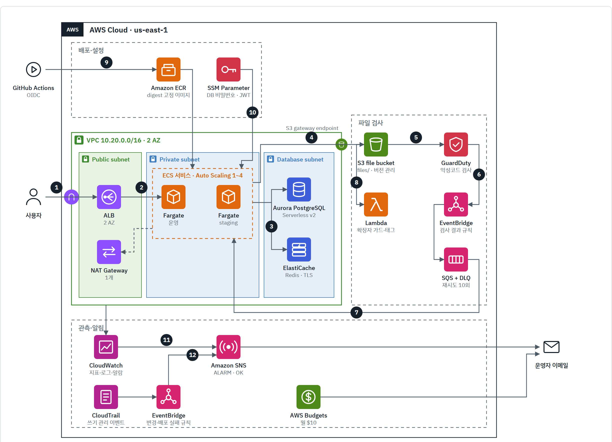

# 파일 공유 서비스 온프레미스 → AWS 마이그레이션

**Enterprise File Sharing Platform Modernization**

Spring Boot 파일 공유 API를 로컬 Docker Compose(온프레미스)에서 운영 기준선으로 만든 뒤, **API·데이터 계약을 그대로 유지한 채** Terraform으로 구성한 AWS로 옮겼습니다. 옮긴 뒤에는 장애와 잘못된 배포를 일부러 넣어 감지·복구·롤백을 수치로 확인했고, 설계 대안을 비교해 개선 세 가지를 같은 조건에서 다시 측정했습니다.

| 기능이 깨진 운영 배포 | 인프라 수동 변경 | DB 복원 | 목록 API 개선 후 처리량 |
| :---: | :---: | :---: | :---: |
| 자동 롤백 **3분 13초** | 탐지 **47초** | RPO **104초** / RTO **15.2분** | **3.5배** (59.4 → 206.9 rps) |



## 무엇을 했나

| 단계 | 내용 |
| --- | --- |
| 1. 온프레미스 기준선 | nginx·Spring Boot·PostgreSQL·Redis·MinIO를 Compose로 띄우고 기능·장애·정합성 시나리오를 통과시켜 이전 뒤 비교할 기준을 만들었습니다. |
| 2. 이전 설계 | 리전·인증·예산·태그 규칙을 정하고, Terraform을 데이터가 남는 유지 계층과 실습마다 지우는 실습 계층으로 나눴습니다. 비밀값은 Terraform state 밖(SSM)에 둡니다. |
| 3. AWS 배포·계약 비교 | 같은 컨테이너 이미지를 프로필만 바꿔 ECS에 배포하고, 온프레미스와 같은 시나리오를 실행해 결과를 비교했습니다. 예상된 차이 2건(S3 키 접두어, 큰 파일 응답 코드) 외에는 같았습니다. |
| 4. 운영 검증 | task 강제 중지, S3 권한 제거, Redis 재부팅, 전체 중단, 깨진 배포, 인프라 drift, DB 시점 복원, 부하·자동 확장을 실제로 일으켜 보고 감지·복구 시간을 쟀습니다. |
| 5. 설계 비교·개선 | ECS/EKS, Aurora/RDS, NAT 구성, S3 경로, 업로드 방식을 정가 기준으로 비교하고, 개선 세 가지를 적용해 같은 조건에서 전후를 측정했습니다. |

## 아키텍처

| 역할 | 온프레미스 (WSL2 + Docker Compose) | AWS (us-east-1, Terraform) |
| --- | --- | --- |
| 진입점 | nginx | ALB (운영·staging 대상 그룹) |
| 애플리케이션 | Spring Boot 컨테이너 | ECS Fargate, Auto Scaling 1~4 |
| DB | PostgreSQL 16 | Aurora PostgreSQL 16 Serverless v2 (0 ACU 자동 일시정지) |
| 캐시 | Redis 7 | ElastiCache Redis |
| 파일 | MinIO | S3 + S3 gateway endpoint |
| 악성코드 검사 | 없음 | GuardDuty → EventBridge → SQS(+DLQ) → backend |
| 배포 | `docker compose up` | GitHub Actions(OIDC) → ECR → staging smoke → 승인 → production, 실패 시 자동 롤백 |
| 관측 | 컨테이너 로그 | CloudWatch 대시보드·SLI·알람 → SNS 이메일, CloudTrail 변경 알림 |

애플리케이션은 포트·어댑터 구조라, 저장소·DB·캐시를 바꿀 때 서비스 코드를 고치지 않고 Spring 프로필만 바꿉니다. 비용 제약(월 $10) 때문에 NAT 1개, Redis 1노드, Aurora 인스턴스 1개로 두었고, 이 단일 AZ 요소는 한계로 명시했습니다.

## 기술 스택

| 영역 | 사용 기술 |
| --- | --- |
| 애플리케이션 | Java 17, Spring Boot 4.1, Spring Security(JWT), Spring Data JPA, Redis(Lua 스크립트), AWS SDK v2 |
| 인프라 | Terraform(모듈 13개, 루트 3개, S3 원격 state·잠금), ECS Fargate, ALB, Aurora Serverless v2, ElastiCache, S3, GuardDuty, Lambda(Python), EventBridge, SQS, SSM |
| CI/CD | GitHub Actions, OIDC, Trivy(이미지·IaC), environment 승인 |
| 관측 | CloudWatch(지표·Logs Insights·대시보드·알람), SNS, CloudTrail |
| 검증 | JUnit 테스트 69개, k6 부하 시험, 장애 주입 스크립트 |

## 주요 성과

| 항목 | 결과 |
| --- | --- |
| 기능 동등성 | 온프레미스 기준선 시나리오를 AWS에서 같은 결과로 통과 |
| task 장애 | 사람 개입 없이 자동 복구. 대상 그룹 연결 정리 시간을 줄여 중단 404초 → 92초 |
| 캐시 장애 | Redis 재부팅 중 오류 0건(DB로 우회) |
| 잘못된 배포 | 기동 실패는 staging에서 자동 롤백되어 운영에 가지 않음. 기능만 깨진 배포는 운영 smoke가 잡아 3분 13초 만에 롤백 |
| 인프라 변경 | 코드 밖 변경을 drift 검사로 47초 만에 탐지, 승인 apply로 복구. drift가 못 보는 보안 그룹·경로 변경은 CloudTrail로 1분 안에 알림 |
| 데이터 복구 | DB 시점 복원 RPO 104초 / RTO 15.2분(목표 5분 / 60분), S3 삭제 복구 15초 |
| 악성코드 | EICAR 시험 파일 2초 만에 격리, 검사 전 409·감염 403으로 다운로드 차단 |
| 부하 | 40 VU에서 오류 0. 목록 커서 페이지 적용 후 같은 task 1개 처리량 3.5배, 조회 p95 1.78초 → 0.12초 |
| 보안 | 장기 access key 0개, 비밀값은 state·환경변수에 없음, 이미지 취약점 예외 0건 |

## 검증하면서 찾아 고친 결함

한 번에 된 것이 아니라 훈련과 측정이 결함 16건을 찾아냈습니다. 대표적인 것은 다음과 같습니다.

- **S3 권한을 잃으면 "파일 없음(404)"으로 응답**: 장애를 사용자 실수처럼 보이게 했습니다. 저장소 접근 실패는 503으로 구분했습니다.
- **짧은 5xx 폭주를 알람이 놓침**: 지표가 1~2분 늦게 들어와 1개 기간 평가가 비어 있었습니다. "3분 중 1번" 평가로 바꿨습니다.
- **전체 중단 때 healthy 지표가 비어 알람이 울리지 않음**: 빈 지표를 0으로 채워(`FILL`) 해결했습니다.
- **Auto Scaling이 확장 뒤 46분 넘게 줄지 않음**: JVM이 힙을 돌려주지 않아 메모리 정책이 축소를 막았습니다. 메모리 정책은 확장만 하도록 바꿔 3 → 1 축소를 확인했습니다.
- **목록 API가 사용자 파일 전체를 반환**: 파일이 쌓일수록 p95가 0.39 → 1.96초로 늘었습니다. 커서 페이지와 인덱스로 고쳐 처리량이 3.5배가 됐습니다.
- **task 교체가 6분 44초 걸림**: 대상 그룹이 이전 task 연결을 300초 동안 정리한 뒤에야 새 task가 떴습니다. 30초로 줄여 92초가 됐습니다.

## 설계 판단

| 선택 | 이유 | 고려한 대안 |
| --- | --- | --- |
| ECS Fargate | 노드 관리 없이 rolling·circuit breaker·Auto Scaling. 1인 운영에 맞음 | EKS(클러스터만 월 $73 추가) |
| Aurora Serverless v2, 0 ACU | 쉬는 동안 스토리지만 과금. 실습처럼 켜진 시간이 짧을 때 가장 쌈 | RDS `t4g.micro`(상시 운영이면 더 쌈) |
| 유지/실습 계층 분리 | 데이터는 남기고 NAT·ALB·컴퓨트는 실습할 때만 띄움. 쉬는 동안 월 $1 미만 | 단일 state |
| S3 gateway endpoint | 요금 없이 S3 트래픽의 NAT 처리 요금을 없앰. 측정으로 확인 | interface endpoint(시간당 과금) |
| 업로드는 서버 중계 유지 | 멱등성·보상·검사 흐름을 유지. 10MiB 한도에서는 절감 효과가 작음 | presigned URL 직접 업로드 |
| 데이터는 옮기지 않음 | 시험 데이터뿐이라 이전 비용이 이득보다 큼 | `pg_dump`/`pg_restore` + 객체 동기화 |

비용은 실제 청구가 아니라 us-east-1 정가 기준 추정입니다. 현재 구성을 상시 운영하면 월 약 $158, 가용성 강화 구성은 약 $268입니다.

## 한계

- NAT·Redis·Aurora 인스턴스가 단일 AZ입니다. 운영으로 전환하면 AZ별 NAT, Redis 복제본, Aurora reader가 필요합니다.
- 도메인이 없어 HTTP로 실습했습니다. 도메인 변수만 넣으면 ACM 인증서와 HTTPS가 켜지도록 코드는 준비돼 있습니다.
- SLO는 실습 세션 단위 측정이며 장기 가용성 실적이 아닙니다.
- 다중 backend 인스턴스의 캐시 무효화 경합, S3 스트리밍 메모리 전후 비교, 실제 청구액 확인은 실행하지 않았습니다.

## 자세히 보기

- [포트폴리오](docs/PORTFOLIO.md): 아키텍처, 흐름, IaC, CI/CD, 보안, 관측, 장애 훈련, 비용, 화면 캡처 30여 장
- 정리 페이지(GitHub에서는 소스로 보이므로 내려받아 브라우저로 여세요. 이미지와 다이어그램이 파일 안에 들어 있습니다)
  - [AWS 이전 기록](docs/assets/aws-migration.html): AWS 구성도, 이전 단계, 운영 검증, 설계 비교와 개선 측정
  - [애플리케이션·온프레미스 구조](docs/assets/architecture-overview.html): Compose 구성, 패키지·계층, 요청 처리, 업로드 흐름
- [설계 비교(ARCH-01)](docs/proposals/ARCH-COMPARISON.md), [결정 기록](docs/DECISIONS.md), [작업일지](docs/worklogs/)

## 저장소 구조

```text
backend/        Spring Boot API (auth, user, file, infra 어댑터, 테스트)
nginx/          온프레미스 리버스 프록시, 확인용 테스트 UI
terraform/      bootstrap, environments/dev-data(유지), environments/dev(실습), modules/ 13개
scripts/        배포·smoke 스크립트, 장애 주입·부하·측정 스크립트(drills/)
.github/        backend CI/CD, Terraform PR plan·승인 apply·drift 검사
docs/           요구사항·설계·결정·검증·작업일지·포트폴리오, assets/(정리 페이지·캡처·측정 원본)
```

## 실행 (온프레미스)

WSL2에서 Docker를 쓸 수 있어야 합니다. 준비 과정은 [로컬 호스트 준비](docs/design/DEPLOYMENT.md#1-로컬-호스트-준비)를 따르세요.

```bash
cp .env.example .env        # DB·MinIO 비밀번호와 JWT secret 교체
docker compose up --build -d
curl http://localhost:8080/api/health
```

브라우저에서 `http://localhost:8080/test/`로 가입·업로드·다운로드를 직접 해 볼 수 있습니다. 검증 시나리오는 [VALIDATION](docs/design/VALIDATION.md), 백엔드 테스트는 `cd backend && ./gradlew test`(JDK 17)입니다. AWS 배포 절차는 [DEPLOYMENT](docs/design/DEPLOYMENT.md)에 있습니다.

## 문서

- [요구사항](docs/PRD.md) · [설계](docs/DESIGN.md) · [작업 목록](docs/TASKS.md) · [현재 상태](docs/PROGRESS.md) · [결정 기록](docs/DECISIONS.md)
- [배포](docs/design/DEPLOYMENT.md) · [마이그레이션](docs/design/MIGRATION.md) · [검증](docs/design/VALIDATION.md) · [AWS 구성](docs/design/AWS.md) · [문제 해결](docs/TROUBLESHOOTING.md)
- 문서 위치와 작성 규칙: [AGENTS.md](AGENTS.md#문서-책임)

모든 수치는 실제 실행 결과이며, 조건·명령·한계는 작업일지에 기록했습니다.
