외부(고객사·면접)에 프로젝트 성과를 설명할 때 쓰는 근거 문서다. 2026-11-23에 실제 실행 결과 기준으로 다시 썼고, 2026-11-24에 PERF-01 결과와 화면 캡처를 넣었고, 같은 날 오후 ARCH-01 설계 비교·개선 3건 전후 측정(S3 gateway endpoint, deregistration delay 30초, 목록 커서 페이지 PERF-02)과 개인 계정 백업 철거를 반영했다. 모든 수치는 작업일지의 실측이며, 실행하지 않은 항목은 **미실행**으로 따로 적는다. 상세 계약·절차는 링크한 기준 문서를 따른다. 이전 포트폴리오 서술은 [이전 문서 요약](LEGACY.md)에 남겼다.

상태 표기: **완료**(실제 AWS·로컬에서 수용 기준 확인) / **구현**(코드·설정만, 실행 증빙 없음) / **미실행**(계획만).

## 1. 한눈에 보기

Spring Boot 파일 공유 API를 로컬 Docker Compose(온프레미스)에서 먼저 운영 기준선으로 만들고, **같은 API·데이터 계약을 유지한 채** Terraform으로 구성한 AWS(ECS Fargate·Aurora PostgreSQL·ElastiCache Redis·S3·GuardDuty·Lambda)로 옮겼다. 옮긴 뒤 "돌아간다"에서 멈추지 않고, **장애를 일부러 주입하고 배포를 일부러 망가뜨려** 감지·복구·롤백이 실제로 동작하는지 수치로 확인했다.

| 지표 | 결과 | 의미 |
| --- | --- | --- |
| 기능 동등성 | 온프레미스 기준선 시나리오 전부 AWS에서 같은 결과(예상된 차이 2건만) | 마이그레이션 전후 계약 유지 |
| 서버 처리 지연 p95 | 목록 10ms, 단건 8ms, 다운로드 101ms | 조회 SLO(200ms) 대비 20배 여유 |
| task 장애 자동 복구 | 중단 약 87초 → 자동 복구 | 사람 개입 없이 서비스 복귀 |
| 캐시(Redis) 재부팅 | 오류 0건(p95 0.43→0.65초) | 캐시 장애가 서비스 장애로 번지지 않음 |
| DB 복원 | RPO 104초 / RTO 15.2분 (목표 5분 / 60분) | 별도 클러스터 PITR로 검증 |
| 악성코드 검사 | 정상 4초 `CLEAN`, EICAR 2초 `INFECTED`·다운로드 차단 | 검사 전·감염 파일은 내려받을 수 없음 |
| 기동 실패 배포 | staging에서 circuit breaker 자동 롤백, 운영 승격 차단 | 깨진 이미지가 운영에 가지 않음 |
| 기능이 깨진 운영 배포 | smoke 감지 → 직전 revision 자동 롤백 **3분 13초** | health는 정상인데 기능이 깨진 경우도 복구 |
| 인프라 drift | 수동 변경 **47초** 만에 탐지 → 승인 apply로 복구 | 코드와 실제의 차이를 놓치지 않음 |
| 계정 밖 백업 | S3 복제 27초, DB dump 58초, 체크섬 일치(11-23 검증) | 검증 후 2026-11-24 철거(DEC-025). 지금은 계정 내 PITR·S3 버전 관리만 |
| 부하·확장 | 40 VU에서 처리량 59.4 → 72.9 rps(+23%), 오류 0 | task 1 → 3 자동 확장, 축소 결함을 찾아 고친 뒤 3 → 1 |
| 측정 기반 개선(ARCH-01) | 목록 커서 페이지로 같은 task 1개 처리량 59.4 → **206.9 rps**, 조회 p95 1.78초 → **0.12초**. task 교체 중단 404초 → **92초**. S3 트래픽 NAT 경유 0 | 비교 → 개선 → 같은 조건 재측정 |
| 검증에서 찾아 고친 결함 | 16건(+ 측정 설계 발견 1건) | [8장](#8-검증하면서-찾아-고친-결함) |

## 2. 문제 정의와 제약

### 목표

- 기업 내부 파일 공유 서비스(인증, 업로드·다운로드·삭제, 메타데이터, 캐시)를 온프레미스와 AWS에서 **같은 기능 기준으로 비교 가능하게** 운영한다([PRD](PRD.md)).
- 이전 대상은 애플리케이션 코드가 아니라 **실행 환경**이다. 저장소·DB·캐시·배포 방식이 바뀌어도 API 계약은 바뀌지 않아야 한다.

### 실제 제약 (설계 판단의 근거)

| 제약 | 설계에 준 영향 |
| --- | --- |
| 부트캠프 **공유 AWS 계정**, 정리 정책이 Owner 태그 없는 리소스와 장기 access key를 지움 | 모든 리소스 Owner 태그 강제(DEC-009), `aws login` 단기 자격 증명(DEC-014), 개인 계정 백업(ADR-002, 검증 후 철거 DEC-025) |
| 월 예산 **$10** | 유지/실습 계층 분리, Aurora 0 ACU 자동 일시정지, NAT 1개, 실습마다 destroy(DEC-008) |
| 1인 운영, 하루 몇 시간 실습 | 사람의 승인은 운영 배포·인프라 적용에만, 나머지는 자동 판정 |
| 실제 운영 트래픽 없음 | SLO는 "실습 세션 단위"로 정의하고 장기 가용성 실적으로 주장하지 않음 |

## 3. 아키텍처

### 온프레미스 (로컬 WSL2 + Docker Compose)

```text
Client → nginx(:8080) → backend(Spring Boot)
                           ├→ PostgreSQL 16  (users, files, upload_requests)
                           ├→ Redis 7        (files:metadata:{id})
                           └→ MinIO          (bucket files)
```

### AWS (us-east-1, Terraform)

```text
                       ┌──────────────────────────── VPC 10.20.0.0/16 (2 AZ) ─────────────────────────────┐
Client ──HTTP(S)──▶ ALB │ public subnet  : ALB, NAT Gateway(1)   private route → S3 gateway endpoint         │
                        │ private subnet : ECS Fargate backend (운영 서비스 + staging 서비스)                 │
                        │ database subnet: Aurora PostgreSQL Serverless v2, ElastiCache Redis (인터넷 경로 없음) │
                        └───────────────────────────────────────────────────────────────────────────────────┘
ECS backend ─▶ S3 file bucket (files/) ─┬▶ Lambda (확장자 가드·메타데이터 태그)
                                        └▶ GuardDuty Malware Protection ─▶ EventBridge ─▶ SQS(+DLQ) ─▶ backend
ECS ─(S3·ECR 이미지 레이어)─▶ S3 gateway endpoint      ECS ─(ECR API·Logs·SSM·SQS)─▶ NAT
GitHub Actions ─OIDC─▶ ECR ─▶ ECS (staging → 승인 → production)
CloudWatch(지표·로그·대시보드·알람) ─▶ SNS ─▶ 이메일      CloudTrail ─▶ EventBridge ─▶ SNS (네트워크 변경 알림)
```

| 구성 | 값 | 이유 |
| --- | --- | --- |
| 리전 | us-east-1 | 서울보다 단가가 낮고 신규 기능이 먼저 나옴(DEC-006) |
| 네트워크 | 2 AZ × public·private·database subnet | ALB만 public. DB·캐시는 인터넷 경로가 없는 subnet |
| NAT | 1개 + S3 gateway endpoint | AZ별 NAT는 월 고정비가 두 배($36.6 → $73.2). 한 AZ 장애 시 아웃바운드가 끊기는 한계를 감수. S3·ECR 레이어는 무료 gateway endpoint로 NAT를 거치지 않음(DEC-026) |
| 컴퓨트 | ECS Fargate 0.5 vCPU / 1GB, 운영 1~4 task + staging 1 task, 운영 target group deregistration delay 30초 | 서버 관리 없음. Kubernetes 운영 부담 없이 rolling 배포·circuit breaker 사용. delay를 기본 300초에서 줄여 task 교체 중단을 줄임(DEC-026) |
| DB | Aurora PostgreSQL 16 Serverless v2, 0~2 ACU, 300초 무연결 시 일시정지 | 온프레미스 PostgreSQL과 스키마 호환. 쉬는 동안 스토리지만 과금 |
| 캐시 | ElastiCache Redis `cache.t4g.micro` 1노드, 전송·저장 암호화 | 원본이 아닌 캐시라 단일 노드로 충분(장애 시 DB 우회) |
| 파일 | S3, `files/` 접두어, 버전 관리·SSE-S3·퍼블릭 차단 | 앱·Lambda·GuardDuty 권한을 접두어로 제한 |

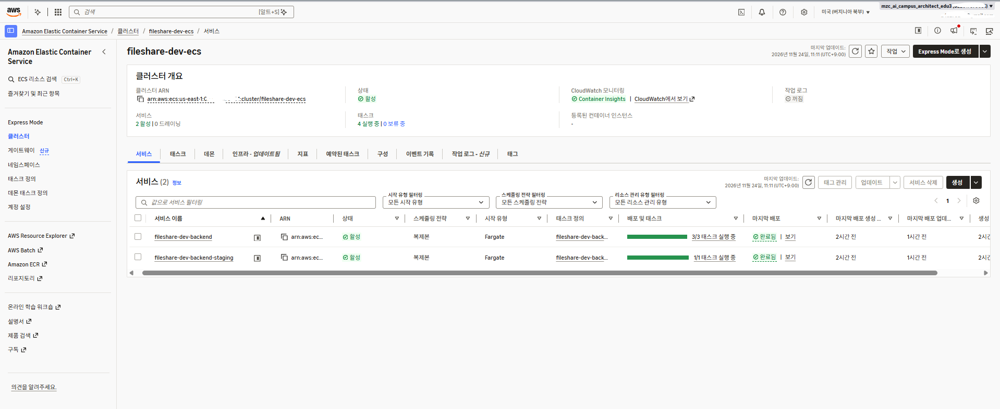
*C05. 한 클러스터에 운영(`backend`)과 staging(`backend-staging`) 서비스(DEC-017).*

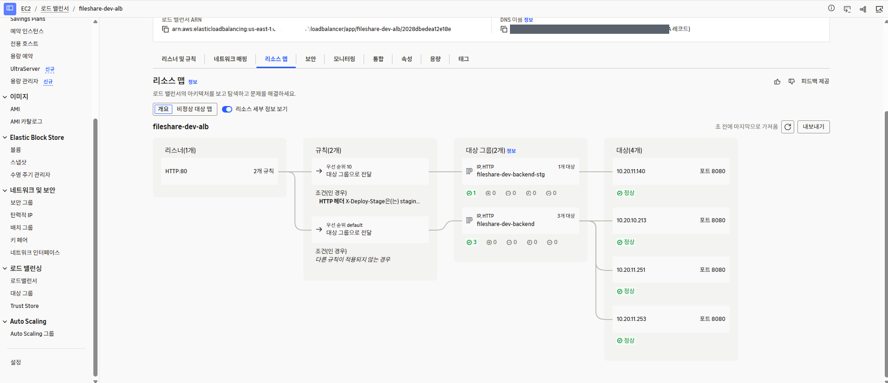
*C11. ALB 리스너 → 규칙(`X-Deploy-Stage` 헤더면 staging) → 대상 그룹 2개 → 정상 대상.*

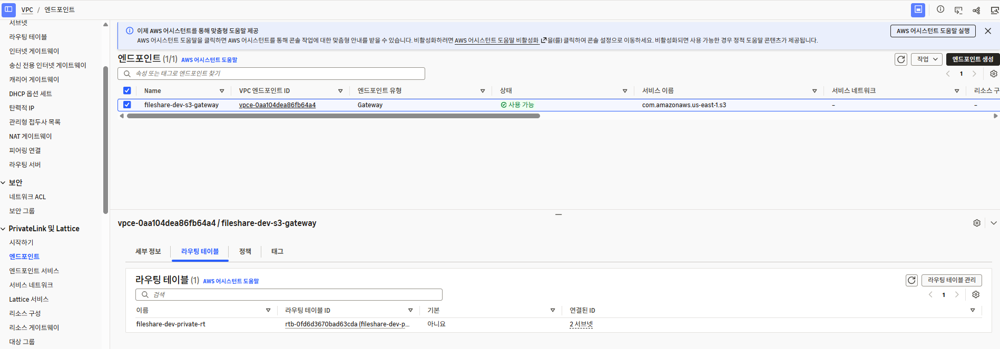
*C28. S3 gateway endpoint(`fileshare-dev-s3-gateway`)가 private route table에 연결됨. backend의 S3 요청과 ECR 이미지 레이어는 NAT를 거치지 않는다(DEC-026).*

### 유지 계층과 실습 계층 (비용 구조의 핵심)

Terraform state를 둘로 나눠 **데이터는 남기고 비싼 컴퓨트만 실습할 때 띄운다**(DEC-008).

| 계층 | 리소스 | 수명 |
| --- | --- | --- |
| 유지(`dev-data`) | VPC·subnet, S3 file bucket, Aurora, SSM DB 비밀번호, ECR, GitHub OIDC·배포/CI role, 알람 SNS, CloudTrail·변경 알림, 예산 | 계속 유지(쉬는 동안 몇 센트) |
| 실습(`dev`) | NAT, S3 gateway endpoint, ALB, ECS·Auto Scaling, ElastiCache, Lambda, GuardDuty 검사 계획·SQS, 대시보드·알람 | 실습마다 apply(약 6분) → destroy |
| 개인 계정(`backup`) | 백업 bucket·policy | 2026-11-24 철거(DEC-025). 복제 규칙·role·bucket 삭제 완료. 개인 계정 IAM user·role은 비용이 없어 남겨 둠(사용자 결정) |

## 4. 기술 스택과 선택 이유

| 영역 | 선택 | 왜 이것인가 | 고려한 대안 |
| --- | --- | --- | --- |
| 애플리케이션 | Spring Boot 4.1(Java 17), Spring Security, JWT | 인증·검증·테스트·운영 설정이 성숙. 무상태 JWT라 Compose·ECS 어디서나 같은 계약 | - |
| 구조 | 포트·어댑터(저장소·캐시·DB를 인터페이스 뒤에) | **같은 이미지**가 프로필만 바꿔 MinIO↔S3, PostgreSQL↔Aurora에서 동작. 마이그레이션 위험을 설정으로 한정 | 환경별 분기 코드 |
| 런타임 | ECS Fargate | 노드 관리 없음, circuit breaker·rolling·Auto Scaling 내장. 1인 운영에 적합 | EKS(제어부 월 고정비·운영 부담, K8S-01 보류) |
| DB | Aurora PostgreSQL Serverless v2 | PostgreSQL 호환 + 0 ACU 일시정지로 쉬는 비용 거의 0, PITR | RDS t4g.micro(상시 약 $14/월), Aurora 상시 0.5 ACU(약 $44/월) |
| 캐시 | ElastiCache Redis | 온프레미스 Redis와 같은 키 계약·Lua 스크립트 | 캐시 없음(조회 지연 증가) |
| 저장소 | S3 (+ gateway endpoint) | 온프레미스 MinIO와 같은 S3 API, 버전 관리·이벤트. gateway endpoint는 요금 없이 NAT 처리비를 없앰 | EFS(비쌈, 이벤트 없음), interface endpoint(AZ 2개 월 $14.6, 이 구성엔 불필요), presigned URL 직접 업로드(API·멱등성·보상 재설계 필요, ARCH-01 미채택) |
| 악성코드 검사 | GuardDuty Malware Protection for S3 | 관리형 엔진, 검사 결과를 이벤트로 받음 | ClamAV Lambda(엔진·정의 DB 운영 부담) |
| 결과 전달 | EventBridge → SQS(+DLQ) → backend | 재시도·DLQ·순서 무관 처리. 결과가 DB보다 먼저 와도 잃지 않음 | Lambda가 DB 직접 갱신(VPC·DB 자격 증명 추가) |
| 후처리 | Lambda(Python 3.12) | 업로드 응답 경로와 분리된 이벤트 처리 | - |
| IaC | Terraform(모듈 13개, 루트 4개) | 네트워크~관측까지 한 언어로 재현, plan으로 변경 검토 | CloudFormation/CDK |
| state | S3 원격 state + S3 자체 잠금 | DynamoDB 테이블 불필요(Terraform 1.11+) | S3 + DynamoDB 잠금 |
| 비밀값 | SSM Parameter Store SecureString | 무료(Standard), ECS `secrets`로 주입 | Secrets Manager(비밀당 $0.40/월, 자동 교체) |
| CI/CD | GitHub Actions + OIDC | 장기 access key 없음, environment 승인·concurrency 내장 | CodePipeline |
| 공급망 검사 | Trivy(이미지·IaC) | 무료, HIGH/CRITICAL 차단, 예외에 만료일 | - |
| 관측 | CloudWatch(지표·Logs Insights·대시보드·알람) + SNS | 추가 에이전트·비용 없이 ALB·ECS·RDS·Lambda를 한 곳에서 | Prometheus/Grafana(운영 부담) |

## 5. End-to-End 흐름

### 업로드 → 검사 → 다운로드 (AWS)

```text
1. Client ── POST /api/files (multipart, Authorization: Bearer, 선택: Idempotency-Key) ──▶ ALB ──▶ ECS
2. RequestLoggingFilter: X-Request-Id 받거나 생성 → 로그 MDC·응답 헤더
3. JWT 검증 → 크기(10MiB)·확장자 검증 → 객체 위치(files/<uuid>) 먼저 결정
4. (키가 있으면) upload_requests에 IN_PROGRESS 기록 — 같은 키 재전송은 첫 결과 반환, 진행 중 409, 다른 내용 422
5. S3에 스트리밍 저장(파일 전체를 메모리에 올리지 않음)
6. Aurora에 메타데이터 저장: status=SCANNING, scan_status=PENDING → Redis 캐시 → 200 응답
   ─── 여기까지가 동기 경로. 아래는 비동기 ───
7a. S3 ObjectCreated → Lambda: 확장자 가드, 크기·타입 태그
7b. GuardDuty가 files/ 객체 검사 → 객체 태그 + 결과 이벤트 → EventBridge → SQS
8. backend가 SQS 소비 → "PENDING이고 삭제되지 않은 행만" 조건부 UPDATE → CLEAN 또는 INFECTED(격리) → 캐시 반영
9. GET /api/files/{id}/download: DB로 판단(캐시 안 씀)
   PENDING → 409 FILE_SCAN_PENDING / INFECTED·FAILED → 403 FILE_QUARANTINED / CLEAN → S3 스트림 반환
```

목록 조회 `GET /api/files?size=20&cursor=…`는 최신순 한 페이지와 `nextCursor`를 돌려준다(PERF-02, DEC-024). 처음에는 본인 파일 전체를 배열로 돌려줬고, 파일이 쌓일수록 느려지는 것을 부하 시험이 찾아냈다([8장](#8-검증하면서-찾아-고친-결함)).

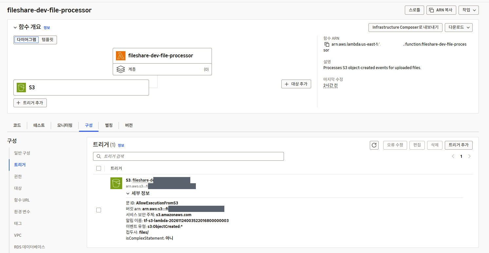
*C13. S3 `files/` ObjectCreated → Lambda `file-processor`(7a).*

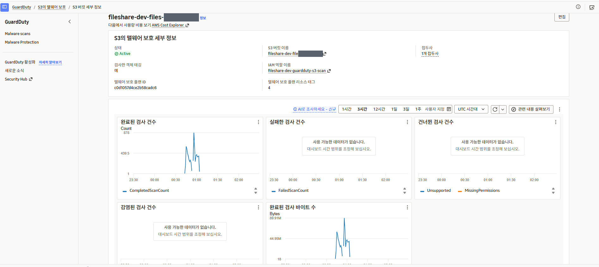
*C14. 파일 bucket `files/` 접두어 보호 플랜(7b).*

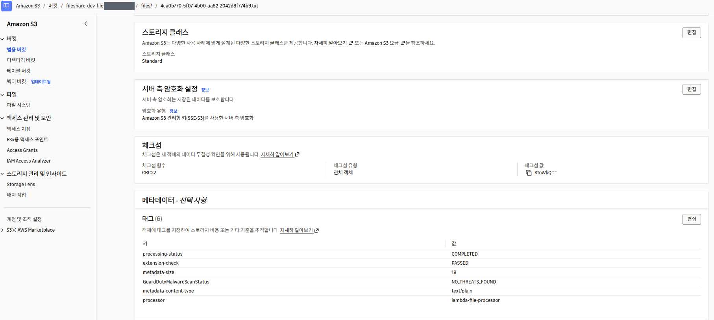
*C25. 정상 업로드 객체: `GuardDutyMalwareScanStatus = NO_THREATS_FOUND`, Lambda의 `extension-check`·크기·타입 태그.*

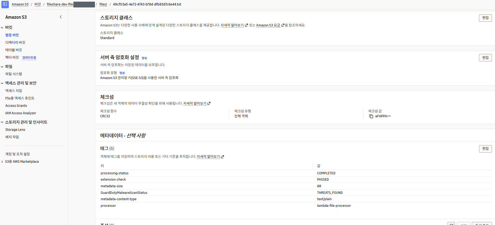
*C25b. EICAR 시험 객체(2026-11-20): `GuardDutyMalwareScanStatus = THREATS_FOUND`. 이 파일은 다운로드가 403으로 막힌다.*

### 실패할 때 어떻게 되는가

| 상황 | 동작 | 근거 |
| --- | --- | --- |
| S3 쓰기 실패 | 정해 둔 위치의 객체 정리, `FILE_UPLOAD_FAILED` | DEC-002 |
| DB 기록 실패, 기록 없음 확인 | 객체 보상 삭제 | DEC-002 |
| DB 기록 결과를 알 수 없음 | **객체를 남김**(지우면 실제 저장된 파일을 잃을 수 있음) → 관리자 고아 객체 점검 API로 정리 | DEC-002 |
| 저장소 접근 불가 | 503 `FILE_STORAGE_UNAVAILABLE`(파일 없음 404와 구분) | OPS-01에서 고친 결함 |
| Redis 장애 | 로그만 남기고 DB로 우회, API 정상 | DEC-003 |
| 삭제와 조회의 경합 | 캐시 쓰기를 `updatedAt` 버전 비교(Lua)로 오래된 값 거부, 삭제는 `deleted`로 덮어씀 | DEC-003 |
| 검사 결과 중복·역순 | 조건부 UPDATE라 무시. 삭제된 파일은 되살아나지 않음 | DEC-018 |
| 검사 결과가 DB 행보다 먼저 도착 | SQS 재시도 10회 → DLQ + 알람 | DEC-018 |
| 15분 넘게 검사 결과 없음 | `FAILED`로 격리(fail closed) | DEC-018 |

인증·삭제·캐시의 상세 흐름은 [DESIGN](DESIGN.md#데이터-흐름), API 계약은 [API](design/API.md)에 있다.

## 6. IaC: Terraform 구성과 운영 방식

### 구성

```text
terraform/
├── bootstrap/            state bucket (로컬 state, 최초 1회)
├── environments/
│   ├── dev-data/         유지 계층 (원격 state, CI는 plan·drift만, 적용은 로컬)
│   └── dev/              실습 계층 (원격 state, CI가 승인 후 apply)
└── modules/              aurora, change-alerts, ecr, ecs, elasticache, file-processor,
                          github-actions, iam, nat, s3, security-groups, terraform-ci, vpc
```

### 원칙

| 원칙 | 구현 | 효과 |
| --- | --- | --- |
| 계층 간 state 의존 없음 | 실습 계층은 유지 계층을 이름·태그로 조회 | 유지 계층 backend를 바꿔도 연결 유지 |
| 비밀값이 state에 없음 | ephemeral `random_password` + write-only 인자(`value_wo`, `master_password_wo`) | tfvars·plan·state 어디에도 평문 없음(DEC-013) |
| 태그 강제 | provider `default_tags` + 모든 모듈 `tags`, Owner 변수 필수 검증 | 공유 계정 정리 정책에서 보호(DEC-009) |
| 책임 분리 | Terraform = 인프라·task definition 템플릿, CD = 실행 revision, Auto Scaling = task 수 (`ignore_changes`) | 배포·확장이 다음 apply에서 되돌려지지 않음(IAC-02) |
| 원격 state | S3(버전 관리·TLS 강제·`prevent_destroy`) + `use_lockfile` | 잠금 경합·`force-unlock`·버전 복구까지 시험(IAC-01) |
| 실수 방지 | Aurora `deletion_protection`·최종 스냅샷, bucket `force_destroy=false` | destroy로 데이터를 잃지 않음 |

### Terraform CI (`.github/workflows/terraform.yml`, DEC-019)

| 트리거 | 단계 | 권한 |
| --- | --- | --- |
| PR | fmt → validate(4개 루트) → Trivy IaC → plan(두 계층, 요약을 PR에) | 읽기 전용 role(`ReadOnlyAccess` + 사용자 파일·비밀값 읽기 거부), 잠금 없이 |
| main push | plan 저장 → **변경이 있을 때만** `terraform-dev` 승인 요청 → **그 plan 파일**을 apply(실습 계층만, 떠 있을 때만) | apply role(PowerUser + `fileshare-dev-*` IAM만, CI role 자신은 수정 불가) |
| 매일 09:00 KST | 두 계층 `plan -detailed-exitcode`로 drift 탐지, 변경 있으면 job 실패 | 읽기 전용 role |

- drift 시험(2026-11-23): 알람 임계값을 CLI로 바꾸자 **47초** 만에 `drift (dev)` 실패와 변경 1건 표시 → 같은 run의 승인 apply로 복구 → 재검사 통과.
- drift 검사가 원리상 못 보는 영역(다른 계층이 별도 리소스로 붙인 보안 그룹 규칙·경로)은 CloudTrail → EventBridge로 **API 호출 자체**를 감시해 메웠다(SEC-03, [9장](#9-보안)).

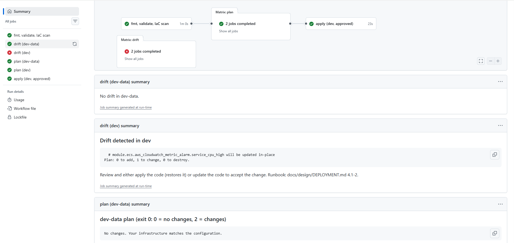
*C24. `drift (dev)` 실패와 변경 리소스 → 같은 run의 승인 apply(2026-11-23).*

## 7. CI/CD 파이프라인

### 애플리케이션 (`.github/workflows/backend-ci-cd.yml`)

```text
PR ─────────▶ test ─▶ image(build + Trivy HIGH/CRITICAL 차단)                 (AWS 접근 없음)

main push / 수동 실행
  test ─▶ image ─▶ publish ─────────────▶ staging ──────────────────▶ production [승인 필요]
                   OIDC 로그인              운영 task 0개면 Aurora 깨우기    롤백 대상(현재 revision) 기록
                   ECR push → digest 확인   같은 revision 배포               같은 revision 배포
                   실습 계층 없으면 종료      rollout 대기(circuit breaker)    smoke + 배포 이후 target 5xx 확인
                   digest 고정 revision 1개  smoke(X-Deploy-Stage 헤더)       실패 → 직전 revision 롤백, workflow 실패
                                                                            성공 → 그 digest에 latest 태그
```

| 장치 | 막는 것 | 실측 |
| --- | --- | --- |
| digest 고정 revision 하나 | staging에서 본 것과 다른 이미지가 운영에 가는 것 | 두 서비스 같은 `taskDefinitionArn` 확인 |
| Trivy 이미지 검사 | 알려진 HIGH/CRITICAL 취약점 이미지 | 예외 0건(SEC-02로 Spring Boot 4 전환 후) |
| staging smoke 8단계 | 기능이 깨진 이미지의 승격(가입·로그인·업로드·검사 대기·다운로드 해시·삭제·404) | 매 배포 |
| production 승인 | 사람이 보지 않은 운영 배포 | GitHub environment required reviewer, main만 |
| ECS circuit breaker | 기동·health 실패 revision의 무한 재시도 | drill A: staging 기동 실패 → 약 7.4분 자동 롤백, 운영 승격 없음 |
| 배포 후 smoke·5xx | health는 정상인데 기능이 깨진 배포 | drill B: 업로드 500 감지 → **3분 13초** 롤백, `latest` 갱신 안 함 |
| `concurrency: deploy-main` | 두 배포의 겹침 | 진행 중 배포는 취소하지 않음 |
| 배포 실패 이벤트 → SNS | circuit breaker 롤백을 아무도 모르는 것 | 이메일 수신 확인 |

소요(2026-11-23 실측): test 24초, build·scan 1분 38초, staging 배포·smoke 2분 24초~3분 48초, production 4분 33초(rollout 191초).
소요(2026-11-24, `ff8e69b`): test 34초, build·scan 1분 58초, staging·smoke 3분 34초, 승인 후 production 5분 35초(rollout 255초 + smoke 71초). deregistration delay를 30초로 줄였지만 **rolling 배포 시간은 줄지 않았다**. 새 task가 정상 판정을 받기까지(약 2분 30초)가 대부분이다. 이전 배포의 세부 이벤트가 남아 있지 않아 190초와 255초의 차이 원인은 미확인이다. delay 단축의 효과는 장애 교체에서 확인했다([11장](#11-고가용성과-회복탄력성)).

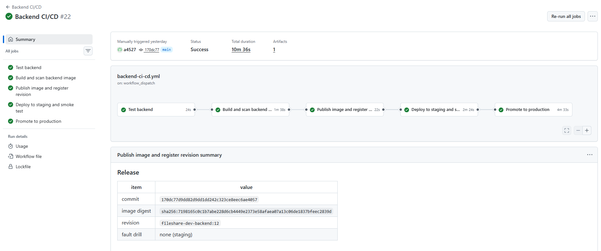
*C22. test → image → publish → staging → production 승인 → production.*

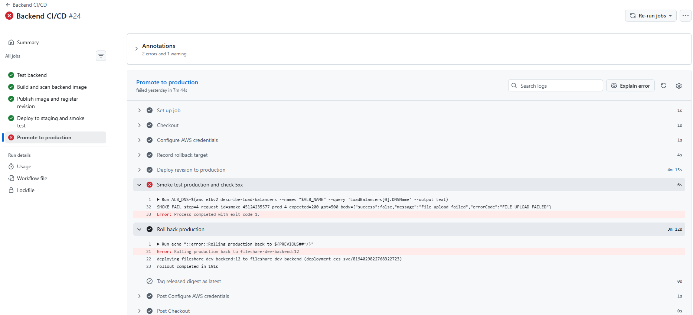
*C23. production smoke 실패 → "Rolling production back" → 롤백 성공, `latest` 갱신 건너뜀(2026-11-23).*

## 8. 검증하면서 찾아 고친 결함

"한 번에 됐다"가 아니라 **훈련이 결함을 찾아냈고 고쳤다**는 것이 이 프로젝트의 핵심 성과다.

| # | 발견 경로 | 결함 | 조치 |
| --- | --- | --- | --- |
| 1 | 문서 재작성 중 검증 | multipart 한도 기본 1MB라 1~10MB 업로드 500 | 한도를 API 계약(10MiB)에 맞춤 |
| 2 | 장애 시나리오 | Redis 명령 timeout 기본 60초, Redis 정지 시 요청이 오래 멈춤 | 짧은 timeout + DB 우회 |
| 3 | 의존성 업그레이드 | 10MiB 초과 업로드가 오류 응답 대신 연결 끊김 | Tomcat 본문 버림 한도를 요청 한도에 맞춤 |
| 4 | 첫 자동 배포 | 배포 role에 `ecr:BatchGetImage` 없어 push 후 manifest 403 | 같은 repository 한정 권한 추가 |
| 5 | V-LOC-04 | Aurora 일시정지 중 backend 기동 시 DB 연결 실패로 종료 | 배포 직전 DB 깨우기(DEC-010) |
| 6 | OPS-01 T3 | S3 권한 상실을 404(파일 없음)로 응답 | 503 `FILE_STORAGE_UNAVAILABLE`로 구분 |
| 7 | OPS-01 T3 | 짧은 5xx 폭주를 알람이 놓침(지표 지연 1~2분) | "3분 중 1번" 평가로 변경 |
| 8 | OPS-01 T5 | 전체 중단 시 healthy 지표가 비어 알람 미발화 | metric math `FILL(raw, 0)` |
| 9 | 첫 승격 배포 | grace period 0초라 기동 중 task를 ECS가 죽임 | grace period 120초 |
| 10 | 첫 승격 배포 | smoke가 ALB를 조회하지 못함(권한) | 배포 role에 읽기 권한 |
| 11 | drill A | circuit breaker 롤백이 알림 없이 끝남 | ECS 배포 실패 이벤트 → SNS |
| 12 | 정기 drift | 계층이 공유하는 SG·경로 때문에 매일 오탐 | `-refresh-only` 대신 일반 plan |
| 13 | 위 수정 분석 | 별도 리소스로 붙인 SG 규칙 변경을 어떤 검사도 못 봄 | CloudTrail 기반 변경 알림(SEC-03) |
| 14 | PERF-01 | 확장 뒤 메모리 정책(JVM 힙 유지)이 축소를 막아 46분 넘게 3 task(비용 3배) | 메모리 정책 확장 전용(`disable_scale_in`), 수정 뒤 3 → 1(DEC-023) |
| 15 | PERF-01 | 목록 API가 본인 파일 전체를 반환(`owner_id` 인덱스도 없음). 시험 중 파일이 쌓이며 ALB p95 0.39 → 1.96초, 분당 요청 5,623 → 2,375 | 커서(keyset) 페이지 + `(owner_id, id)` 인덱스(PERF-02, DEC-024). 같은 조건에서 59.4 → 206.9 rps, 조회 p95 1,783 → 121ms |
| 16 | task 중지 재실행 | 운영 target group deregistration delay 기본 300초 동안 새 task를 띄우지 않아 중단 6분 44초 | delay 30초(DEC-026). 재측정 중단 92초, 새 task가 연결 정리 시작 2초 뒤 기동 |
| (발견) | ARCH-01 측정 | k6가 private subnet에서 ALB 공인 DNS를 호출해 **시험 트래픽이 NAT를 왕복**(기준선 응답 방향만 약 3.4GB, 약 $0.15) | 미수정. 다음 부하 시험은 k6를 VPC 밖이나 public subnet에서 실행 |

작업 방식 사고도 기록했다: 로컬 apply 뒤 늦게 push한 커밋 때문에 CI가 코드 기준으로 규칙 2개를 지웠다. 교훈은 "CI가 apply하는 계층은 머지 → CI apply 순서"이고, 이후 지켰다([작업일지](worklogs/2026-11-20.md#첫-승격-배포와-ci-사고)).

## 9. 보안

| 영역 | 적용 | 근거·검증 |
| --- | --- | --- |
| 네트워크 경계 | ALB만 public. ECS는 private, Aurora·Redis는 인터넷 경로 없는 database subnet | [AWS](design/AWS.md#security-group-설계) |
| 보안 그룹 | ALB ← 80/443, app ← ALB 8080, Aurora ← app 5432, Redis ← app 6379만 | 규칙은 SG 참조(ID), CIDR 개방 없음 |
| 최소 권한 IAM | 앱·Lambda·GuardDuty는 `files/*`만(백업 철거 전에는 dump task `backups/db/*` 쓰기만, 복제 role 원본 읽기·대상 복제만) | 신뢰 정책에 `aws:SourceAccount`·`aws:SourceArn`(혼동된 대리인 방지) |
| 자격 증명 | 사람: `aws login` 단기 세션(개인 계정 MFA role은 백업 철거로 2026-11-24부터 미사용). CI: GitHub OIDC(브랜치·environment별 subject) | 장기 access key 0개(DEC-014) |
| CI 권한 분리 | plan role(읽기 전용, 사용자 파일·비밀값 거부) / apply role(승인 environment만, 자기 자신 수정 불가) / 배포 role(ECR·ECS 한정) | fork PR에는 OIDC 토큰 없음 |
| 비밀값 | DB 비밀번호·JWT secret을 Terraform이 생성해 SSM SecureString에 write-only로 기록, ECS `secrets`로 주입 | task definition 환경변수에 비밀값 0개, state·plan에 평문 없음 |
| 암호화 | S3 SSE-S3, Aurora 저장 암호화, Redis 전송·저장 암호화, state bucket TLS 강제 | CMK 미사용은 Trivy 예외에 사유·만료일 |
| 공급망 | Trivy 이미지 검사(예외 0건) + IaC 검사(HIGH/CRITICAL, 예외 8건 모두 사유·만료일 2027-05-31) | 만료되면 다시 차단 |
| 업로드 파일 | 확장자·크기 검증, GuardDuty 검사, 검사 전·감염 파일 다운로드 차단(fail closed) | V-SCAN, EICAR 차단 |
| 애플리케이션 | BCrypt, JWT, 남의 파일 403·무토큰 401·관리자 전용 403, ALB `drop_invalid_header_fields` | V-FUNC-03 |
| 로그 위생 | 접근 로그에 본문·쿼리·토큰·비밀번호·파일 내용 없음 | 15분 로그에서 토큰·`Bearer`·비밀번호 0건 |
| 변경 감시 | Terraform CI 밖에서 Aurora SG·route table을 바꾸면 1분 안에 이메일(CloudTrail → EventBridge → SNS), trail 중지·규칙 비활성화도 알림 | 실제 임시 규칙으로 수신 확인(SEC-03) |
| 백업 보호 | (철거 전) 개인 계정 bucket: 퍼블릭 차단·버전 관리·복제 role만 쓰기·TLS 강제, 관리 role에 버전 삭제 권한 없음. 이 권한 설계 때문에 철거 시 사본은 사용자가 콘솔에서 직접 지워야 했다 | BACKUP-01, DEC-025 |

**알려진 한계**: 도메인이 없어 실습은 HTTP다(도메인 변수만 넣으면 TLS 1.3 정책 HTTPS + 리다이렉트). WAF 미적용. VPC endpoint는 S3 gateway만(ECR API·Logs·SSM·SQS는 NAT 경유). 토큰 갱신·로그아웃 API 미구현. staging과 운영이 데이터 계층을 공유한다(헤더 라우팅은 보안 경계 아님).

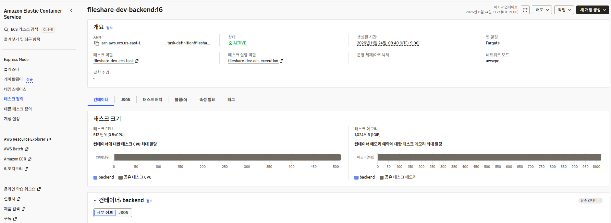
*C12. 운영 서비스가 쓰는 작업 정의 `fileshare-dev-backend:16`: task role·execution role 분리, 0.5 vCPU / 1GB.*

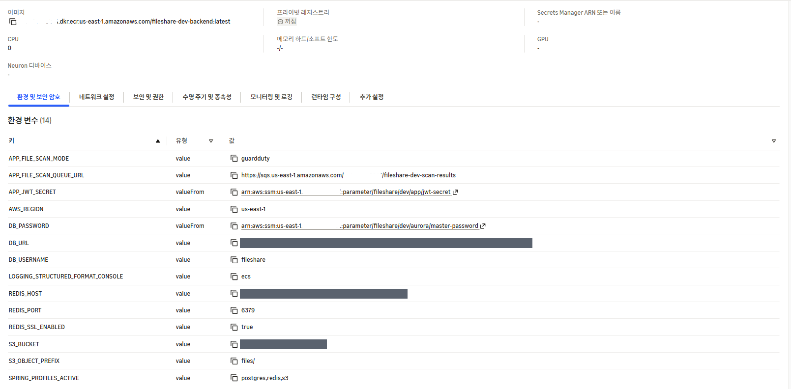
*C12b. `DB_PASSWORD`·`APP_JWT_SECRET`은 `valueFrom`(SSM 파라미터 ARN)이고 나머지 환경 변수에 비밀값이 없다. 엔드포인트·bucket 이름은 가렸다.*

## 10. 모니터링·로그·알람

### 무엇을 보는가 (대시보드 `fileshare-dev-service`)

| 위젯 | 지표 | 보는 이유 |
| --- | --- | --- |
| ALB 요청·오류 | RequestCount, Target 5xx, ELB 5xx | 진입점 가용성. ELB 5xx는 앱이 아니라 "target 없음·연결 실패" |
| 응답 시간 | TargetResponseTime p50/p95/p99 | 사용자 체감 지연 |
| target health | Healthy/Unhealthy host | 서비스 중단 여부 |
| ECS | CPU·메모리 %, running vs desired | 용량, 복구 진행 |
| Aurora | ServerlessDatabaseCapacity(ACU), 연결 수 | DB 부하·일시정지 상태 |
| Redis | hit/miss, 연결 수 | 캐시 효과 |
| Lambda | 호출·오류·Duration p95 | 후처리 상태 |
| 알람 | 전체 알람 상태 | 한 화면 판단 |
| 경로별 SLI | Logs Insights 위젯 | API별 품질 |

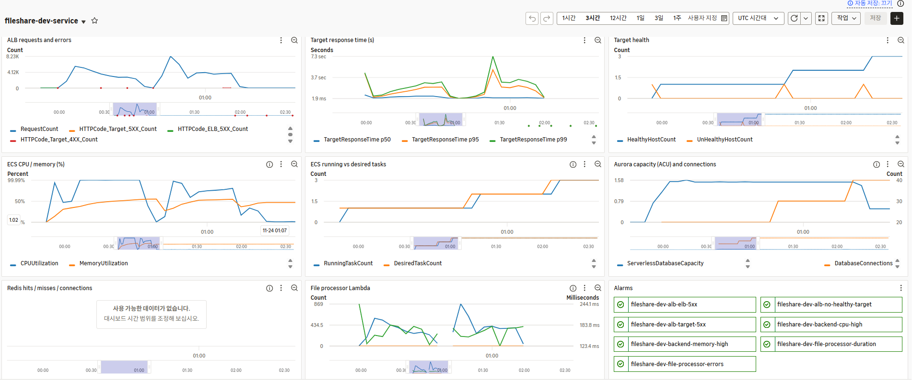
*C01. 대시보드 `fileshare-dev-service`, PERF-01 시간대(2026-11-24 09:40~10:10 KST): 부하 두 번, task 1 → 2 → 3.*

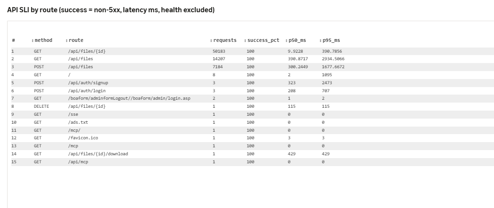
*C02. 같은 대시보드의 경로별 요청 수·성공률·p50/p95.*

### SLI·SLO (실습 세션 단위, [VALIDATION 11장](design/VALIDATION.md#11-관측-지표와-sli))

| SLI | 측정 | 목표 | 실측(11-20) | 목표 근거 |
| --- | --- | --- | --- | --- |
| 조회 가용성 | 접근 로그 비 5xx 비율 | 99% | 100% | 하루 몇 시간 켜는 환경이라 99.9%는 측정 자체가 무의미 |
| 조회 지연 p95 | 서버 처리 `durationMs` | 200ms | 목록 10ms·단건 8ms | 실측의 20배 여유(Aurora 재개 직후·캐시 미스·GC) |
| 전송 가용성 | 업로드·다운로드 비 5xx | 99% | 100% | 조회와 같음 |
| 전송 지연 | `durationMs` p95 | 기록만 | 다운로드 101ms, 업로드 약 10초 | 클라이언트 대역폭에 좌우돼 서버 품질 지표로 부적합 |

### 알람: 무엇을, 왜, 언제 (모두 ALARM과 OK를 SNS 이메일로)

| 알람 | 언제 울리나 | 왜 이 기준인가 | 실측 |
| --- | --- | --- | --- |
| `alb-target-5xx` | backend 5xx ≥1건, 1분 단위·**3분 중 1번** | 요청이 적어 한 건도 의미 있음. 지표가 1~2분 늦게 들어와 1개 기간 평가는 놓침(OPS-01) | - |
| `alb-elb-5xx` | ALB 자체 5xx ≥1건, 3분 중 1번 | target이 없을 때 앱이 아니라 ALB가 502/503을 냄. target 5xx로는 못 잡음 | task 중지 → 약 3분에 ALARM |
| `alb-no-healthy-target` | healthy 최소 <1이 2분, **데이터 없음도 장애** | "완전 중단"만 따로. 짧은 중단은 ELB 5xx가 맡음 | target이 없으면 지표가 비는 문제를 `FILL(raw,0)`으로 해결 |
| `backend-cpu-high` / `memory-high` | 평균 60% / 70% 초과 10분 | Auto Scaling 목표값과 같고 기간을 길게 둬, **확장으로도 해소 안 되는 지속 과부하만** 알림 | - |
| `file-processor-errors` | Lambda 오류 ≥1, 3분 중 1번 | 후처리 실패 = 태그 누락. 업로드 API와 분리된 경로임을 구분 | 실패 주입 → 약 1분 40초 ALARM |
| `file-processor-duration` | p95 > 10초, 10분 | Lambda timeout(30초) 전에 경고 | - |
| `scan-results-dlq` | DLQ 메시지 ≥1, 1분 | 검사 결과를 반영 못 함 → 파일이 PENDING에 묶임 | 실제 DB 없는 결과로 발화 확인 |
| ECS 배포 실패(EventBridge) | circuit breaker 롤백 즉시 | 이벤트라 지표 알람으로 못 잡음 | 이메일 수신 |
| 네트워크 변경(EventBridge, SEC-03) | Terraform CI 밖 SG·경로 변경 즉시 | drift 검사가 못 보는 영역 | 1분 안에 이메일 |
| 예산 | 실제 50·80·100%, 예측 100% | 월 $10 한도 | 아래 비용 한계 참고 |
| Terraform drift | 매일 09:00 KST, 변경 시 job 실패 | 코드와 실제 차이 | 47초 탐지 |

- 데이터 없음은 정상(`notBreaching`)으로 본다(요청이 없으면 5xx 지표도 없다). 예외는 `alb-no-healthy-target`.
- 감지는 즉시가 아니다: 지표 지연 1~2분 + 평가 주기. OK 복귀는 6~8분. 알람별 진단·복구·에스컬레이션 런북은 [DEPLOYMENT 4.11-1](design/DEPLOYMENT.md#411-1-알람-대응-obs-02).

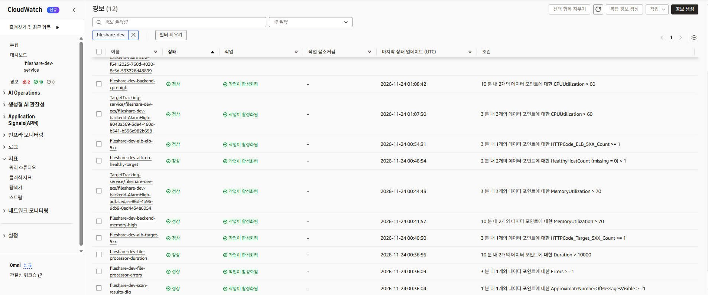
*C10. 운영 알람 전체와 Auto Scaling이 만든 target tracking 알람.*

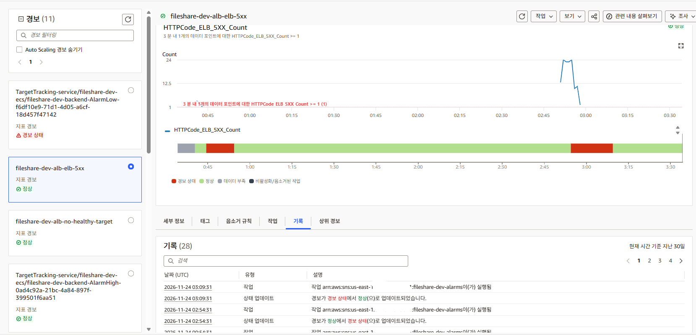
*C15. task 중지 주입 때 `alb-elb-5xx`의 OK → ALARM → OK와 "Successfully executed action".*

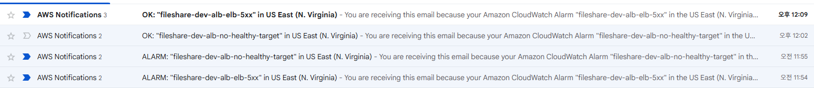
*C16. 같은 알람의 ALARM·OK 이메일.*

### 로그를 어떻게 쓰는가

| 로그 | 보존 | 쓰임 |
| --- | --- | --- |
| backend `/ecs/fileshare-dev-backend` (JSON) | 14일 | 요청마다 `requestId`·`route`(ID 제거 패턴)·`status`·`durationMs` → 경로별 SLI 쿼리, 장애 시 요청 추적 |
| 응답 헤더 `X-Request-Id` | - | 고객 문의의 요청 ID 하나로 서버 로그 전체를 찾음(저장 쿼리 `request-trace`) |
| ECS task 중지 이벤트 `/aws/events/...-ecs-task-stopped` | 14일 | ECS가 1시간 뒤 지우는 중지 사유(exit code, health 실패)를 보존 |
| Lambda 로그 | 14일 | 후처리 실패 원인 |
| CloudTrail trail(쓰기 관리 이벤트) | 7일 | 누가 무엇을 바꿨나, 변경 알림의 원천 |

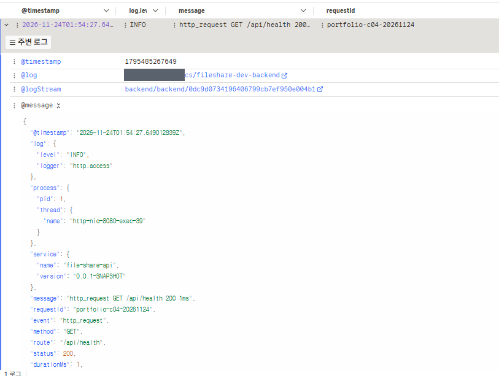
*C03. 저장 쿼리 `request-trace`: 요청 ID 하나의 JSON 로그 줄.*

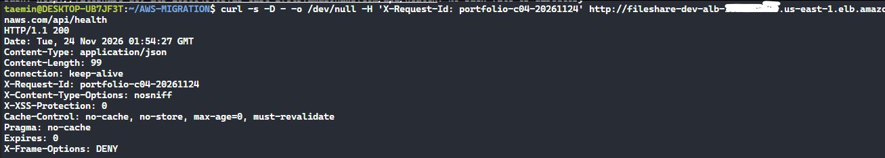
*C04. `curl -D -` 응답의 `X-Request-Id`가 C03과 같은 값.*

로그 유실 점검: 분당 접근 로그 수 = ALB RequestCount(차이는 health check 분당 2회). 이후 계획: 로그 기반 지표 필터(예: `Compensating object delete failed` 건수), 5xx 비율 알람, 장기 보존은 S3 내보내기.

## 11. 고가용성과 회복탄력성

### 설계

| 장애 | 대비 | 한계 |
| --- | --- | --- |
| task 하나 죽음 | ECS가 desired로 복구, ALB health check, Auto Scaling(CPU 60%·메모리 70%, 확장 60초·축소 300초 cooldown, 1~4) | 실습은 task 1개라 교체 동안 중단(약 87초). 운영 권장은 최소 2(예시 tfvars 2) |
| 나쁜 배포 | circuit breaker + smoke·5xx 롤백 + 승인 | 롤백 동안 수 분의 오류 |
| 캐시 장애 | DB 우회 | 캐시 없는 동안 지연 증가 |
| DB 장애·실수 | Aurora PITR(보존 1일)·삭제 보호·최종 스냅샷 | 인스턴스 1개(reader 없음)라 장애 조치 동안 중단 |
| 객체 삭제·덮어쓰기 | S3 버전 관리 | - |
| 계정 정리·계정 손실 | 2026-11-24까지: 개인 계정 S3 교차 계정 복제 + DB dump(검증 완료). 이후 철거(DEC-025) | 지금은 계정 내 PITR·S3 버전 관리뿐. 데이터가 시험 데이터라 위험 수용 |
| AZ 장애 | subnet·ALB 2 AZ | NAT 1개, Redis 1노드, Aurora 1인스턴스는 단일 AZ |

### 실측 (장애 주입 훈련)

| 훈련 | 사용자 영향 | 감지 | 복구 |
| --- | --- | --- | --- |
| 운영 task 강제 중지 | 약 87초 502/503 | `alb-elb-5xx` 약 3분 | 자동, running=desired |
| 없는 이미지로 배포 | 없음(기존 task 유지) | 서비스 이벤트 | circuit breaker 적용 후 자동 |
| DB 사용자 틀린 배포 | 없음 | 기동 실패 로그 | 롤백 |
| task role에서 S3 권한 제거 | 업로드 500 6건 | 요청 ID 추적 | 정책 복원 → 결함 2건 수정 |
| Redis 노드 재부팅(약 2분) | 없음(p95 0.43→0.65초) | - | 자동 |
| 서비스 전체 중단(desired 0, 4분) | 503/502 | `alb-elb-5xx` 약 4분 | 복원 후 52초 → 결함 수정 |
| Lambda 실패 주입 | 없음(태그만 누락) | 약 1분 40초 | - |
| DB PITR 복원 | - | - | RPO 104초 / RTO 15.2분, 행 수·객체·크기·해시 일치 |
| S3 삭제 복구 | - | - | 15초, 같은 해시 |
| 공유 계정이 Aurora를 외부에서 정지(실제 사건) | 실습 시작 시 DB 연결 불가 | dump task timeout | `start-db-cluster` 약 5분. 계정 밖 백업을 두었던 이유의 실례 |
| 운영 task 강제 중지 재실행(11-24 오전) | 약 6분 44초 503/502 | `alb-elb-5xx` 약 3분, `alb-no-healthy-target` 약 4분 40초(2분 넘는 중단의 발화 첫 확인) | 이전 task 연결 정리(deregistration delay 300초)가 끝난 뒤에야 새 task 시작. 11-20(87초)과 차이 원인 미확인 |
| 같은 훈련, delay 30초(11-24 오후) | **92초** 503 | - | 연결 정리 시작 2초 뒤 새 task 시작, 28초 뒤 대상 등록(DEC-026) |

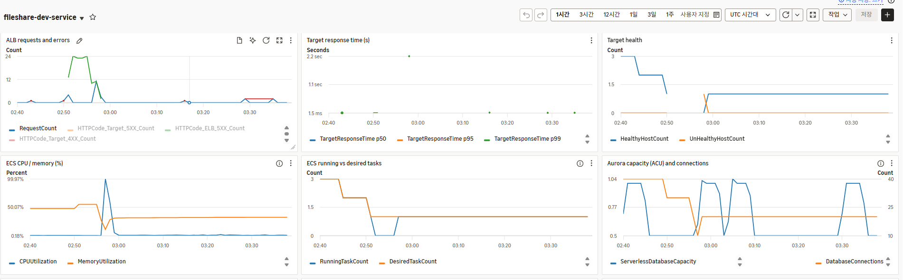
*C17. 운영 task 강제 중지(2026-11-24 11:51 KST): ELB 5xx 급증, healthy 0 → 1 회복.*

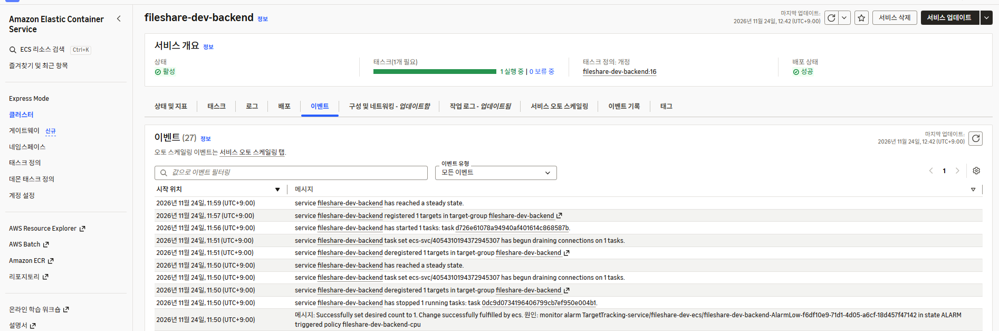
*C18. stopped → started → registered 순서.*

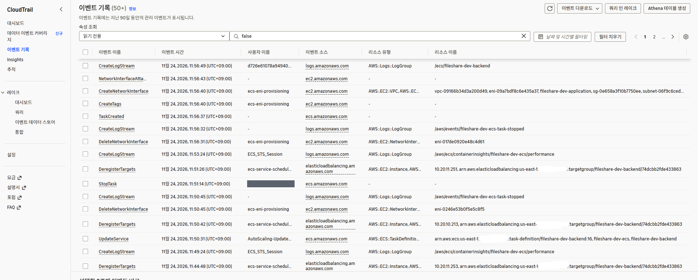
*C19. 의도한 장애 주입 호출(시각·호출자).*

### 부하·확장 실측 (PERF-01, 2026-11-24)

AWS 안의 k6 ECS task로 40 VU(증가 2분·유지 6분·감소 1분), 단건 조회 70%·목록 20%·100KB 업로드 10%를 같은 조건으로 두 번 실행했다.

| 조건 | 처리량 | 오류율 | 읽기 p50 / p95 | 업로드 p50 / p95 | task |
| --- | --- | --- | --- | --- | --- |
| 기준선: task 1개 고정 | 59.4 rps | 0% | 207ms / 1.78s | 520ms / 1.69s | 1 (CPU 100% 포화) |
| Auto Scaling 1~4 | 72.9 rps (+23%) | 0% | 82ms / 1.78s | 199ms / 2.20s | 40초 만에 2, 종료 직전 3 |

- 목록 API에 페이지 처리가 없어, 시험 중 쌓이는 파일 수만큼 목록 응답이 무거워진다(기준선 분당 요청 5,623 → 2,375). p95가 줄지 않은 주원인이다.
- 확장 후 task가 46분 넘게 줄지 않았다: CPU 1%여도 JVM 메모리가 47%로 남아 메모리 정책이 축소를 막았다. 메모리 정책의 축소를 끄자(`disable_scale_in`) 적용 7초 뒤 3 → 2, 6분 뒤 2 → 1로 줄었다([작업일지](worklogs/2026-11-24.md)).

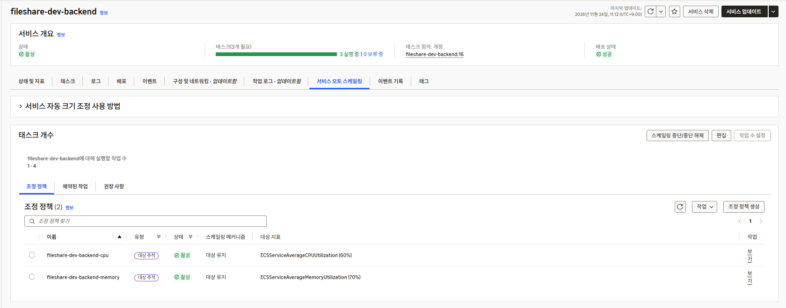
*C06. CPU 60%·메모리 70% target tracking, 최소 1·최대 4.*

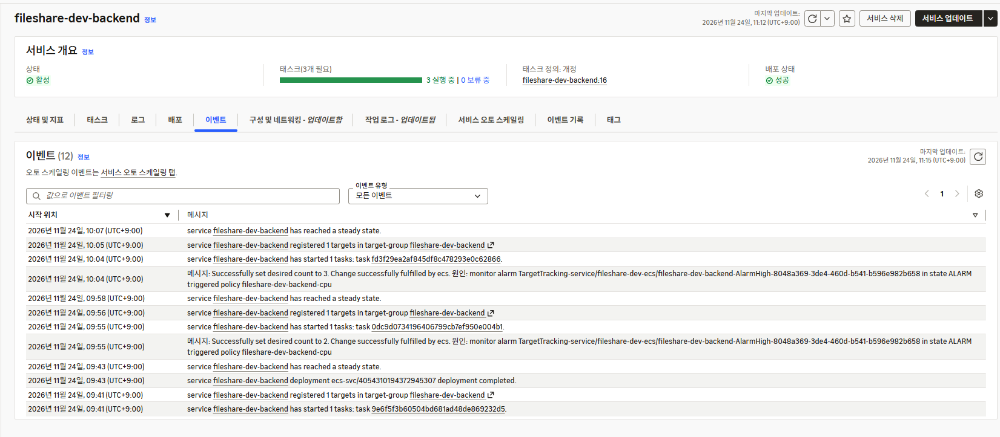
*C07. 서비스 이벤트: 09:55·10:04 KST task 추가와 대상 등록.*

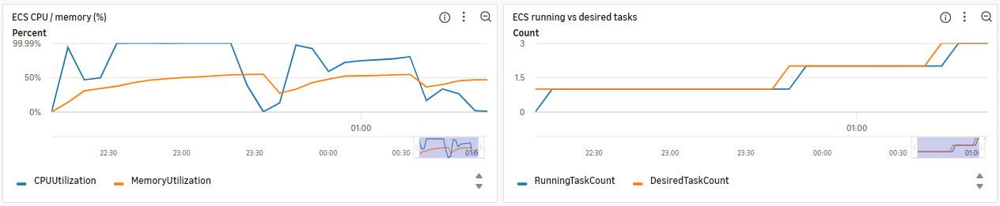
*C08. 부하 종료 후 CPU 1%, 메모리 47% 유지, task 3개(수정 전).*

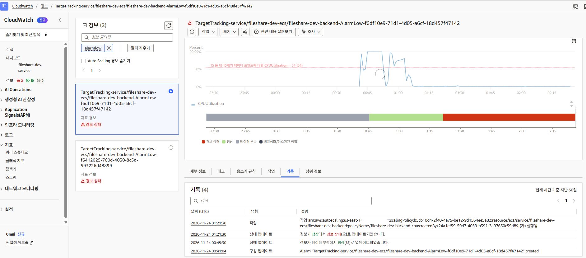
*C09. CPU·메모리 `AlarmLow` 둘 다 ALARM인데 축소 활동 없음(수정 전).*

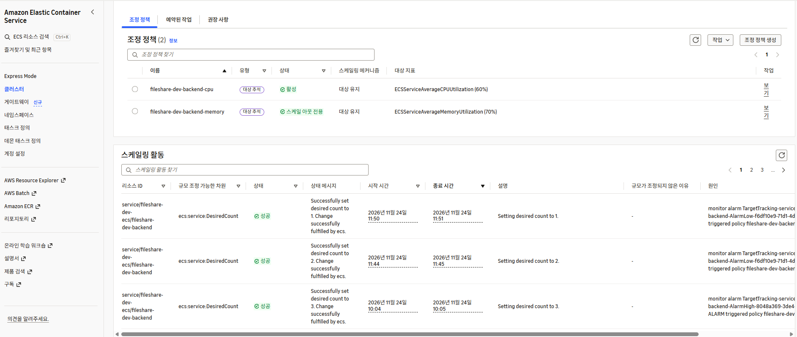
*C20. 수정 후 3 → 1 축소 활동.*

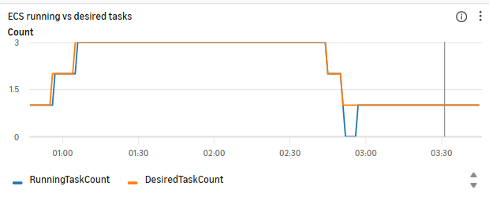
*C21. task 수 1 → 3 → 1 전체 주기.*

### 개선 후 재측정 (ARCH-01·PERF-02, 2026-11-24 오후)

같은 k6 스크립트·같은 조건(task 최대 1개, 40 VU)으로, 목록 커서 페이지·S3 gateway endpoint·delay 30초를 적용한 뒤 다시 쟀다. 변경 전 값은 오전 기준선이다. 원본: [arch-01](assets/arch-01/), [설계 비교](proposals/ARCH-COMPARISON.md#측정한-개선).

| 지표 | 변경 전 | 변경 후 |
| --- | --- | --- |
| 처리량 | 59.4 rps (32,141건) | **206.9 rps (113,194건)** |
| 조회 p50 / p95 / p99 | 207 / 1,783 / 2,913ms | **11 / 121 / 199ms** |
| 업로드 p95 | 1,694ms | **394ms** |
| ALB p95 추이 | 0.39 → 1.96초(파일이 쌓일수록 증가) | 0.28 → 0.09초(파일 11,477건이 쌓여도 증가 없음) |
| 오류율 | 0 | 0 |
| 업로드 바이트당 NAT 송신 바이트 | 약 2.25배(추정: k6 → ALB + backend → S3) | 1.12배(S3 몫이 빠짐) |
| S3 업로드·다운로드 210MB 동안 NAT 처리 | - | 0.6MB |
| task 중지 중단 | 404초 | **92초** |

- 변경 후에는 task 1개 CPU가 95~100%로 처리량 한계였고, 조회 지연은 낮게 유지됐다.

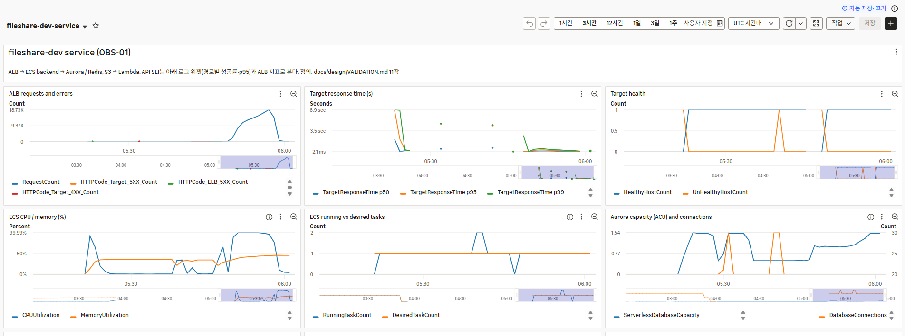
*C27. 개선 후 부하(05:50~06:00 UTC = 14:50~15:00 KST): 분당 요청이 1.8만 건까지 늘어도 응답 시간 p95가 낮게 유지된다. 변경 전 C01에서는 p95가 계속 올랐다.*

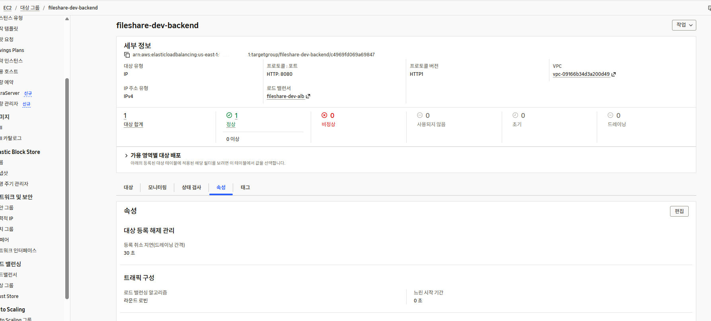
*C29. 운영 대상 그룹의 등록 취소 지연(draining) 30초(이전 300초).*

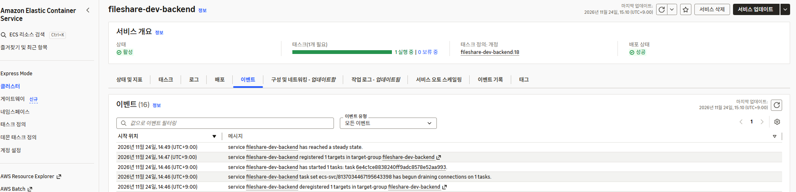
*C30. delay 30초에서 task 중지: draining 시작(14:46:49) 2초 뒤 새 task 시작, 14:47 등록. 변경 전 C18은 연결 정리가 끝날 때까지 약 5분 기다렸다. 중단 404초 → 92초.*
- 한계: 세 변경을 함께 적용해 처리량 증가에서 endpoint 몫은 분리하지 않았다(업로드는 요청의 10%). `(owner_id, id)` 인덱스가 Aurora에 실제로 만들어졌는지는 DB 직접 조회 경로가 없어 확인하지 않았다. rolling 배포 시간은 줄지 않았다([7장](#7-cicd-파이프라인)).

목표: RPO 5분 / RTO 1시간(DEC-020). 기준과 절차는 [백업 복원](design/DEPLOYMENT.md#412-1-백업-복원-ops-02), [개인 계정 백업](design/DEPLOYMENT.md#412-2-개인-계정-백업-backup-01)(2026-11-24 철거).

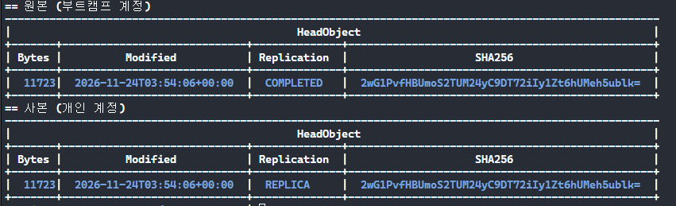
*C26. 원본 `COMPLETED`, 개인 계정 사본 `REPLICA`, 같은 SHA-256(2026-11-24 철거 전 이력).*

## 12. 비용

### 설정 근거

| 결정 | 근거 |
| --- | --- |
| 유지/실습 계층 분리 | NAT·ALB·Fargate·Redis는 켜진 시간만큼 과금 → 실습 때만. 데이터는 유지 |
| Aurora 0 ACU 자동 일시정지 | 비교(2026-11-18): 0.5 ACU 상시 약 $44/월, RDS t4g.micro 상시 약 $14/월, 0 ACU는 스토리지만(몇 센트) |
| NAT 1개 + S3 gateway endpoint | AZ별 NAT는 고정비 두 배. 실습 환경의 가용성 요구보다 비용 우선. S3 트래픽의 NAT 처리비($0.045/GB)는 무료 endpoint로 없앰(DEC-026) |
| SSM Standard, CMK 미사용 | 비밀값·키 월 고정비 없음 |
| 로그 보존 14일, trail 사본 7일 | 저장 비용 상한 |
| 예산 $10 + 이메일(실제 50/80/100%, 예측 100%) | 공유 계정 한도 |

### 규모 (정가 기준 추정, 실제 청구로 확인 전)

| 상태 | 시간당/월 |
| --- | --- |
| 실습 계층이 떠 있을 때 | 시간당 약 $0.2~0.3 (NAT 약 $0.045 + ALB 약 $0.023 + Fargate 2 task 약 $0.05 + Redis 약 $0.016 + Aurora 활성 ACU) |
| 쉬는 동안 | 월 $1 미만(S3·Aurora 스토리지, ECR 이미지, 알람 SNS) |

**한계**: 예산이 Owner 태그로 필터되는데, 2026-11-23 Cost Explorer에서 Owner 태그 비용이 0으로 나왔다. Owner가 비용 할당 태그로 활성화되지 않은 것으로 보인다. 조직 관리자 확인은 하지 않고 닫았으므로(**미실행**, 2026-11-24) 위 금액은 실제 청구가 아니라 정가 추정이다.

### 설계 비교 (ARCH-01, us-east-1 정가, 산정일 2026-11-24)

AWS Pricing API로 조회한 정가 기준 추정이다. 가정: AZ 2개, 상시 730시간, DB 20GB, ALB LCU 1개, NAT 처리 데이터는 별도. 상세는 [설계 비교](proposals/ARCH-COMPARISON.md).

| 구성 | 상시 운영(월) | 실습 시간당 |
| --- | --- | --- |
| 저비용 실습 구성(현재) | 약 $158 | 약 $0.22 |
| 가용성 강화(운영 task 2, AZ별 NAT, Redis 복제본, Aurora reader) | 약 $268(DB를 RDS Multi-AZ로 하면 약 $232) | 약 $0.37 |

| 비교 | 결론 | 핵심 근거 |
| --- | --- | --- |
| ECS Fargate vs EKS | ECS 유지 | EKS 클러스터만 월 $73 추가 + add-on·버전 관리 부담(K8S-01 보류) |
| Aurora Serverless v2 vs RDS | 실습은 Aurora 유지 | 쉬는 동안 0 ACU. 한 달 약 230시간 넘게 깨어 있으면 RDS `t4g.micro`($14.0)가 쌈 |
| NAT 1개 vs AZ별 vs Regional | 1개 유지 | AZ별은 $36.6 → $73.2. Regional NAT는 과금 방식 미확인으로 후보만 |
| S3 endpoint 없음/gateway/interface | **gateway 채택** | 요금 $0, NAT 장애 때도 S3 경로 유지. interface는 AZ 2개 월 $14.6 |
| ECS 중계 vs presigned URL | 중계 유지 | presigned는 API·멱등성·보상·검사 흐름 재설계 필요, 10MiB 한도에서 절감은 몇 센트 |

이 실습에서 가장 큰 변동비는 부하 시험 트래픽의 NAT 왕복이었다([8장](#8-검증하면서-찾아-고친-결함) 발견 항목).

## 13. 검증 전략과 결과

| 층위 | 방법 | 결과 |
| --- | --- | --- |
| 단위·통합 테스트 | JUnit, H2(PostgreSQL 모드), 모의 Redis·S3, 응답 없는 Redis 포트, 실제 서블릿 multipart 한도, 목록 페이지 경계·잘못된 값 | 69개 통과, PR마다 CI |
| 계층 규칙 | 서비스가 API DTO·보안 타입을 모르게(LAYER-01/02) | 테스트로 고정 |
| 온프레미스 기준선 | V-ONP·V-FUNC·V-DATA·V-IDEM·V-FAIL·V-ADMIN 시나리오와 Lua 버전 비교, 18개 항목 | 전부 통과(11-17) |
| 배포 전 로컬 검증 | 같은 이미지를 `s3` 프로필·컨테이너 한도로(V-LOC) | 통과, DB 일시정지 기동 문제 발견(DEC-010) |
| 계약 동등성 | 같은 시나리오를 AWS에서(VERIFY-01) | 동일. 차이 2건은 예상된 것(S3 키 접두어, 큰 파일을 nginx 413 대신 앱 400) |
| 장애·복구 | 11장 훈련 10종 | 위 표 |
| 성능 smoke | 9MB 10건 동시 업로드 | 전부 200, 메모리 +46MB(스트리밍 확인) |
| 관측 | 요청 ID 추적, SLI, 알람 발화·이메일 | 통과 |
| 배포 통제 | drill A(기동 실패)·drill B(기능 실패) | 둘 다 자동 롤백 |
| IaC | PR plan, 승인 apply, drift 주입·복구, 잠금·state 복구 | 통과 |
| 백업 | 복제·삭제 미반영·dump·체크섬·경계 | 통과(11-23), 2026-11-24 철거 |
| 부하·확장 | k6 기준선(task 1) vs Auto Scaling(1~4) | **완료**(PERF-01). 처리량 +23%, 축소 결함 발견·수정. 목록 API 페이지 처리 없음이 p95 한계 |
| 설계 비교·개선 | 정가 비교 + 개선 3건을 같은 조건으로 재측정(ARCH-01, PERF-02) | **완료**. 처리량 3.5배, 조회 p95 1,783 → 121ms, task 교체 중단 404 → 92초, S3 트래픽 NAT 경유 0 |

시나리오 정의와 판정 기준은 [VALIDATION](design/VALIDATION.md).

## 14. 운영 절차

| 상황 | 절차 |
| --- | --- |
| 실습 시작 | `dev` apply(약 6분) → CD가 ECR `latest`로 기동, 운영 task 0개면 DB 깨우기 |
| 배포 | main 머지 → 자동 staging → 승인 → production. 수동 실행도 가능 |
| 인프라 변경 | PR(plan 검토) → 머지 → `terraform-dev` 승인 → 저장된 plan apply |
| 알람 수신 | [런북](design/DEPLOYMENT.md#411-1-알람-대응-obs-02): 대시보드 → 요청 ID 추적 → 서비스 이벤트 |
| 실습 종료 | 남길 로그·지표 내보내기 → `dev` destroy → `dev-data` plan 변경 없음 확인 |
| 부하 시험 | 새 사용자로 시험 → 결과·지표 보존(복제 철거로 일시 중지 단계 없음) |
| 문제 해결 | [TROUBLESHOOTING](TROUBLESHOOTING.md)(증상·원인·해결·재검증 형식) |

## 15. 한계와 다음 단계

| 항목 | 상태 | 계획 |
| --- | --- | --- |
| 부하·확장(PERF-01/02) | 완료. 목록 API 커서 페이지로 같은 조건 처리량 3.5배(PERF-02) | k6 실행 위치를 바꿔 NAT 왕복 없이 재시험 |
| task 교체 중단 | delay 30초로 92초(이전 6분 44초) | 최소 task 2로 중단 자체를 없애기 |
| 비용·설계 비교(ARCH-01) | 완료(정가 추정 + 개선 3건 재측정) | Regional NAT 과금 방식 확인, 실제 청구로 검증 |
| 단일 AZ 요소 | NAT·Redis·Aurora 인스턴스 | 운영 전환 시 AZ별 NAT, Redis 복제본, Aurora reader |
| HTTPS | 도메인 없음 | 변수 2개로 활성화(코드 준비됨) |
| 배포 속도 | 운영 rollout 190~255초. delay 단축으로는 줄지 않음 | 새 task 정상 판정 시간(health check 간격·grace) 조정 검토 |
| 데이터 이전 | 하지 않음(시험 데이터뿐, DEC-007) | 실제 이전이면 `pg_dump`/`pg_restore` + 객체 동기화 |
| 계정 밖 백업 | 검증 후 철거(DEC-025) | 실제 운영이면 다시 둔다(교차 계정 복제 + 스냅샷 공유) |
| 비용 실측 | **미실행**(Owner 비용 할당 태그 확인 안 함, 정가 추정만) | 실제 운영이면 비용 할당 태그 활성화 후 Cost Explorer로 |
| 다중 인스턴스 캐시 경합(FILE-02) | **미실행**. 단일 인스턴스 검증과 Redis 재부팅 중 DB 우회까지만 | 실제 운영이면 backend 2대에서 삭제 직후 무효화 경합 재현 |
| S3 스트리밍 메모리 전후 비교(FILE-04) | **미실행**. 변경 후 90MB 동시 업로드에 메모리 277 → 323MB만 관찰 | 같은 조건으로 변경 전 이미지와 비교 |
| Kubernetes | 보류(K8S-01) | 목표 직무 필요 시 EKS 비교 |

## 16. 발표 흐름 제안 (20분 기준)

1. **문제**(2분): 공유 계정·$10 예산·1인 운영이라는 제약이 설계를 결정했다.
2. **아키텍처**(4분): 3장 그림. 계층 분리, 같은 이미지가 프로필로 환경을 바꾼다는 점.
3. **E2E 흐름**(3분): 업로드 → 비동기 검사 → 검사 전 다운로드 차단. 실패 표에서 "결과 불명이면 지우지 않는다".
4. **배포 파이프라인**(4분): digest 하나가 staging → 승인 → production. drill B 3분 13초 롤백을 화면으로.
5. **운영**(4분): 대시보드·SLI·알람 기준과 이유. 장애 훈련 표, 부하 시험에서 찾은 축소 결함, 찾은 결함 16건. 측정 → 개선 → 재측정(처리량 3.5배, 교체 중단 404 → 92초).
6. **보안·비용**(2분): 장기 키 0개, 비밀값 state 밖, 쉬는 비용 월 $1 미만. 정가 비교로 고른 것(gateway endpoint)과 고르지 않은 것(EKS·presigned URL·AZ별 NAT).
7. **한계와 다음 단계**(1분): 단일 AZ 요소, 배포 시간이 줄지 않은 것, 부하 시험의 NAT 왕복, 계정 밖 백업 철거를 먼저 말한다.

## 17. 증빙

### 대표 아키텍처 자료

| 자료 | 내용 | 비고 |
| --- | --- | --- |
| [애플리케이션·온프레미스 구조](assets/architecture-overview.html) | Compose 구성·실행 흐름, 패키지·계층·의존성, 요청 처리(필터·JWT·포트·어댑터), 프로필별 빈, 업로드 흐름 | 2026-11-24 기준. 게시본 「File Share API 아키텍처」 |
| [AWS 이전 기록](assets/aws-migration.html) | 온프레미스→AWS 대응, AWS 구성도, 이전 단계, IaC·CI/CD, 결함, 보안, 관측, 회복탄력성, 비용·설계 비교, 캡처 C01~C30 | 2026-11-24 기준, 캡처를 파일 안에 내장(단독으로 열림). 게시본 「File Share AWS 이전 기록」 |
| 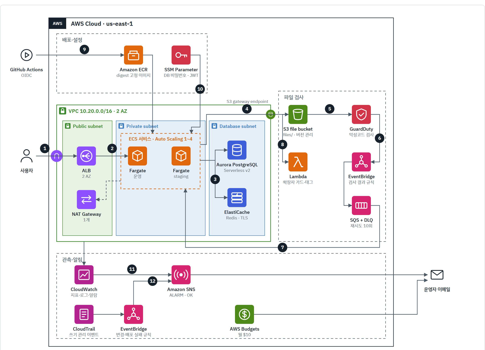 | AWS 구성도(위 페이지 그림을 PNG로) | 루트 README에도 사용 |

### 작업별 근거

| 설명할 내용 | 작업 | 상태 | 근거 |
| --- | --- | --- | --- |
| 온프레미스 기능·장애 기준선 | ONP-02/03 | 완료 | [11-17](worklogs/2026-11-17.md#온프레미스-구축과-검증) |
| AWS 배포·계약 동등성 | MIG-02, VERIFY-01 | 완료 | [11-20 1회차](worklogs/2026-11-20.md#1회차-자동-배포-첫-실행과-mig-02verify-01) |
| 자동 복구·관측·알람 | VERIFY-02, OBS-01/02 | 완료 | [11-20 2회차](worklogs/2026-11-20.md#2회차-verify-02와-obs-0102) |
| 장애 훈련·복원 | OPS-01/02 | 완료 | [11-20 3단계](worklogs/2026-11-20.md#3단계-실행) |
| 악성코드 검사 | FILE-03 | 완료 | [11-20](worklogs/2026-11-20.md#file-03cicd-03-실행-결과) |
| 승격 배포·롤백 | CICD-02/03 | 완료 | [11-20](worklogs/2026-11-20.md#첫-승격-배포와-ci-사고), [11-23](worklogs/2026-11-23.md#실습-sec-02-배포iac-03-driftcicd-03-drill-b) |
| IaC CI·drift | IAC-01/03 | 완료 | [11-23](worklogs/2026-11-23.md#실습-sec-02-배포iac-03-driftcicd-03-drill-b) |
| 비밀값·공급망·변경 감시 | SEC-01/02/03 | 완료 | [11-20](worklogs/2026-11-20.md#sec-01-비밀값-주입), [11-23](worklogs/2026-11-23.md#sec-03-terraform-밖-네트워크-변경-알림) |
| 계정 밖 백업 | BACKUP-01 | 완료 후 철거(DEC-025) | [11-23](worklogs/2026-11-23.md#backup-01-개인-계정-백업), [11-24 철거](worklogs/2026-11-24.md#개인-계정-백업-철거-dec-025) |
| 부하·확장 | PERF-01 | 완료 | [11-24](worklogs/2026-11-24.md#perf-01-부하확장-v-perf-03) |
| 목록 커서 페이지 | PERF-02 | 완료 | [11-24](worklogs/2026-11-24.md#arch-01perf-02-변경-후-측정), [API](design/API.md#get-apifiles) |
| 비용·설계 비교 | ARCH-01 | 완료 | [설계 비교](proposals/ARCH-COMPARISON.md), [11-24](worklogs/2026-11-24.md#arch-01perf-02-변경-후-측정), [원본](assets/arch-01/) |

### 화면 캡처 목록

캡처는 `docs/assets/captures/`에 **아래 파일명 그대로** PNG로 저장한다(Windows 탐색기: `\\wsl.localhost\Ubuntu-24.04\home\taemin\AWS-MIGRATION\docs\assets\captures\`). 본문의 이미지 자리가 이 파일명을 가리키므로 저장하면 해당 장에 바로 보인다. 파일이 없는 동안은 깨진 이미지로 보이며 상태 열이 "대기"다. 저장 전 계정 ID·이메일·ALB DNS·bucket 이름을 가린다.

시점: **지금** = 실습 계층이 떠 있고 이미 데이터가 있음(destroy하면 사라짐) / **주입 후** = 운영 task 중지 주입 뒤(약 2분 중단) / **수정 후** = 축소 결함 수정 뒤 / **언제든** = destroy 후에도 남음. 시간 범위는 PERF-01 화면이면 2026-11-24 09:40~10:10 KST(절대 시간).

| ID | 파일 | 콘솔 위치 | 꼭 보일 것 | 넣는 곳 | 시점 | 상태 |
| --- | --- | --- | --- | --- | --- | --- |
| C01 | `c01-dashboard.png` | CloudWatch → 대시보드 `fileshare-dev-service` 위쪽 | 부하 두 번, task 1 → 2 → 3 | [10장](#10-모니터링로그알람) | 지금 | 완료 |
| C02 | `c02-sli-table.png` | 같은 대시보드 아래 | 경로별 요청 수·성공률·p50/p95 | 10장 | 지금 | 완료 |
| C03 | `c03-request-trace.png` | CloudWatch → Logs Insights → 저장 쿼리 `fileshare-dev/request-trace` | 요청 ID 하나의 JSON 로그 줄 | 10장 | 지금 | 완료 |
| C04 | `c04-curl-request-id.png` | 터미널 | `X-Request-Id`가 C03과 같은 값 | 10장 | 지금 | 완료 |
| C05 | `c05-ecs-services.png` | ECS → 클러스터 `fileshare-dev-ecs` → 서비스 | 운영·staging 서비스 2개 | [3장](#3-아키텍처) | 지금 | 완료 |
| C06 | `c06-scaling-policy.png` | 서비스 `fileshare-dev-backend` → 서비스 Auto Scaling | CPU 60·메모리 70, 최소 1·최대 4 | [11장](#11-고가용성과-회복탄력성) | 지금 | 완료 |
| C07 | `c07-scale-out-events.png` | 같은 서비스 → 이벤트 | 09:55·10:04 KST task 시작·대상 등록 | 11장 | 지금 | 완료 |
| C08 | `c08-scale-in-blocked.png` | 대시보드 ECS 위젯, 시간 범위 09:40~현재 | CPU 1%, 메모리 47% 평평, task 3 | 11장 | 지금(수정 전) | 완료 |
| C09 | `c09-alarm-low.png` | CloudWatch → 경보 → `TargetTracking-...AlarmLow` 2개 | 둘 다 ALARM | 11장 | 지금(수정 전) | 완료 |
| C10 | `c10-alarm-list.png` | CloudWatch → 경보 → 모든 경보 | 운영 알람 목록 | 10장 | 지금 | 완료 |
| C11 | `c11-alb-resource-map.png` | EC2 → 로드 밸런서 `fileshare-dev-alb` → 리소스 맵 | 리스너 → 규칙 → 대상 그룹 2개 → 정상 대상 | 3장 | 지금 | 완료 |
| C12 | `c12-taskdef-secrets.png` | ECS → 작업 정의 `fileshare-dev-backend:16` | 개정 번호, task·execution role | [9장](#9-보안) | 지금 | 완료 |
| C12b | `c12b-taskdef-secrets.png` | 같은 개정 → 컨테이너 `backend` → 환경 및 보안 암호 | `valueFrom` 두 개(SSM ARN), 나머지 값에 비밀값 없음 | 9장 | 지금 | 완료 |
| C13 | `c13-lambda-trigger.png` | Lambda `fileshare-dev-file-processor` → 개요 | S3 트리거 → 함수 | [5장](#5-end-to-end-흐름) | 지금 | 완료 |
| C14 | `c14-guardduty-plan.png` | GuardDuty → S3용 악성코드 보호 | 파일 bucket 보호 플랜 | 5장 | 지금 | 완료 |
| C15 | `c15-alarm-history.png` | 경보 `fileshare-dev-alb-elb-5xx` → 기록 | OK → ALARM → OK, "Successfully executed action" | 10장 | 주입 후 | 완료 |
| C16 | `c16-alarm-email.png` | 메일함 | ALARM·OK 이메일 | 10장 | 주입 후 | 완료 |
| C17 | `c17-task-stop-dashboard.png` | 대시보드, 주입 시간대 | ELB 5xx 급증, healthy 0 → 1 | 11장 | 주입 후 | 완료 |
| C18 | `c18-task-stop-events.png` | 서비스 → 이벤트 | stopped → started → registered | 11장 | 주입 후 | 완료 |
| C19 | `c19-cloudtrail-stoptask.png` | CloudTrail → 이벤트 기록, 이름 `StopTask` | 시각·호출자 | 11장 | 주입 후(90일 남음) | 완료 |
| C20 | `c20-scale-in.png` | 서비스 → 이벤트 또는 Auto Scaling 활동 | 3 → 1 축소 | 11장 | 수정 후 | 완료 |
| C21 | `c21-scaling-cycle.png` | 대시보드 task 수 위젯, 09:40~축소 후 | 1 → 3 → 1 | 11장 | 수정 후 | 완료 |
| C22 | `c22-actions-pipeline.png` | GitHub Actions `backend-ci-cd` 성공 run | test → … → production 승인 | [7장](#7-cicd-파이프라인) | 언제든 | 완료 |
| C23 | `c23-drill-b-rollback.png` | GitHub Actions run 45124235577 | smoke 실패 → 롤백 성공 | 7장 | 언제든 | 완료 |
| C24 | `c24-terraform-drift.png` | GitHub Actions run 45123423656 summary | `drift (dev)` 실패·변경 1건, 승인 apply | [6장](#6-iac-terraform-구성과-운영-방식) | 언제든 | 완료 |
| C25 | `c25-s3-object-tags.png` | S3 → 파일 bucket → `files/` 객체 → 태그 | `GuardDutyMalwareScanStatus`, Lambda 태그 | 5장 | 언제든 | 완료 |
| C25b | `c25b-s3-threat-tags.png` | S3 → 파일 bucket → EICAR 시험 객체(11-20) → 태그 | `GuardDutyMalwareScanStatus = THREATS_FOUND` | 5장 | 언제든 | 완료 |
| C26 | `c26-backup-compare.png` | 터미널 `head-object`(원본·사본) | `COMPLETED`/`REPLICA`, 같은 SHA-256(2026-11-24 철거 전 이력) | 11장 | 언제든 | 완료 |
| C27 | `c27-dashboard-after.png` | 대시보드 `fileshare-dev-service`, 2026-11-24 14:45~15:02 KST | 요청 수, ALB p95 0.28 → 0.09초, task 1 CPU 100%(C01과 비교) | 11장 | 지금 | 완료 |
| C28 | `c28-s3-gateway-endpoint.png` | VPC → 엔드포인트 `fileshare-dev-s3-gateway` → 라우팅 테이블 | 유형 Gateway, `fileshare-dev-private-rt` 연결 | 3장 | 지금 | 완료 |
| C29 | `c29-tg-deregistration.png` | EC2 → 대상 그룹 `fileshare-dev-backend` → 속성 | 등록 취소 지연 30초 | 11장 | 지금 | 완료 |
| C30 | `c30-task-stop-events-after.png` | 서비스 `fileshare-dev-backend` → 이벤트, 14:46~14:48 KST | draining 시작 → 2초 뒤 새 task 시작 → 등록(C18과 비교) | 11장 | 지금 | 완료 |
| C31 | `c31-paged-list.png` | 터미널 또는 test-ui | `?size=2` 응답의 `items`·`nextCursor` | 5장 | 지금 | 생략(production 확인은 [작업일지](worklogs/2026-11-24.md#arch-01perf-02-변경-후-측정)) |

ALB의 리스너·네트워크 매핑·보안·모니터링 탭과 개별 지표 화면은 캡처하지 않는다. 같은 내용을 2026-11-24 [작업일지](worklogs/2026-11-24.md)의 구성 스냅숏 표와 `assets/perf-01/` 원본 데이터로 남긴다.

## 관련 문서

- [DESIGN](DESIGN.md): 구조와 데이터 흐름
- [DECISIONS](DECISIONS.md): 결정과 대안(DEC-001~026, ADR-001~002)
- [DEPLOYMENT](design/DEPLOYMENT.md): 로컬 호스트·온프레미스·AWS 배포, 런북
- [MIGRATION](design/MIGRATION.md): 전환 절차
- [VALIDATION](design/VALIDATION.md): 검증 시나리오와 SLI
- [AWS](design/AWS.md): Terraform 리소스 해설
