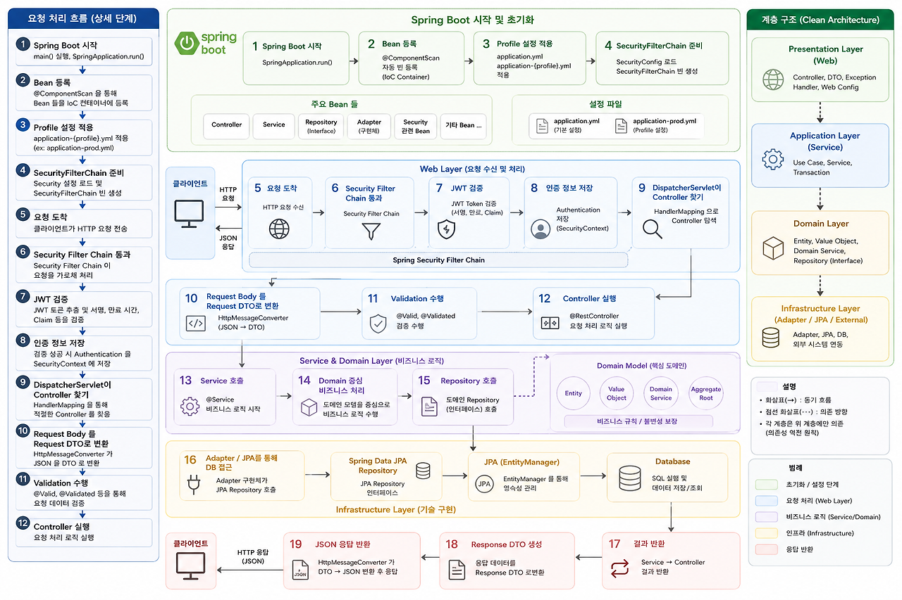
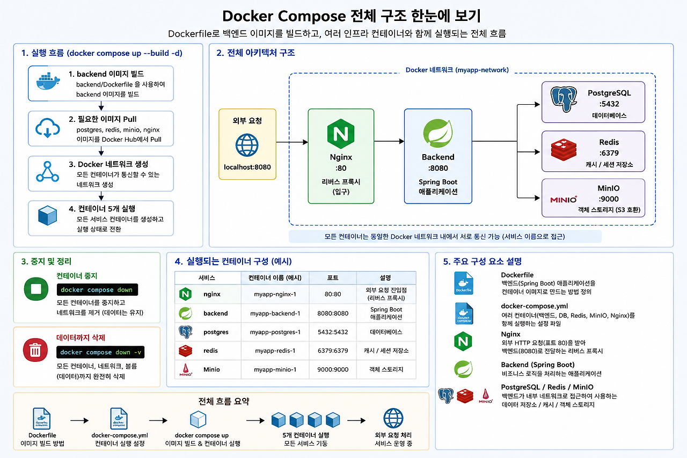
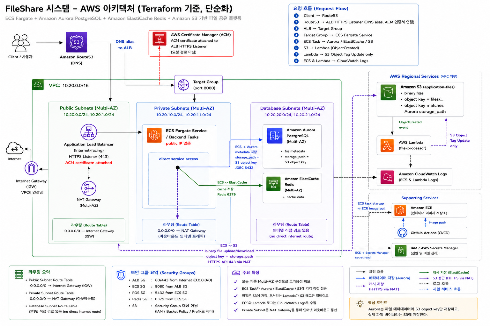

외부에 프로젝트를 설명할 때 쓰는 근거 문서다. 2026-11-17에 현재 코드 기준으로 다시 썼으며, 실행 증빙은 새 진행 단계(온프레미스 구축 → AWS 마이그레이션)에서 채운다. 증빙이 없는 항목은 "계획"으로 표시하고 완료로 설명하지 않는다. 이전 포트폴리오 서술은 [이전 문서 요약](LEGACY.md)에 남겼다.

## 프로젝트 한 줄 소개

Spring Boot 파일 공유 API를 로컬 Docker Compose(온프레미스)에서 운영 기준선을 만든 뒤, 같은 API·데이터 계약을 유지한 채 Terraform으로 구성한 AWS(ECS Fargate, Aurora PostgreSQL, ElastiCache Redis, S3, Lambda)로 옮기는 마이그레이션 프로젝트다.

## 대표 아키텍처 자료

| 자료 | 내용 | 비고 |
| --- | --- | --- |
| [아키텍처 페이지](assets/architecture-overview.html) | 온프레미스·AWS 구성도, 패키지·계층·의존성, 업로드 흐름, Terraform 모듈, CI/CD | 현재 코드 기준 |
|  | 요청 처리와 계층 구조 | 재구성 전 이미지, 구조는 유효 |
|  | 온프레미스 Compose 구성 | 재구성 전 이미지, 구조는 유효 |
|  | AWS 구성 | 현재 Terraform과 같은 구성 |

## 설계 포인트

| 주제 | 내용 | 근거 |
| --- | --- | --- |
| 인프라 교체 가능 구조 | 저장소·캐시·DB를 포트 뒤에 두고 프로필로 구현체를 고른다. 같은 이미지가 MinIO·S3, PostgreSQL·Aurora에서 동작한다 | [DESIGN](DESIGN.md#애플리케이션-구조) |
| 업로드 실패 복구 | 객체를 먼저 쓰고 DB 기록을 재시도한다. 기록 없음이 확인될 때만 보상 삭제하고, 결과 불명이면 객체를 남겨 관리자 점검으로 정리한다 | [DEC-002](DECISIONS.md#결정-목록) |
| 멱등 업로드 | `Idempotency-Key`를 DB에 기록해 재전송을 한 번만 처리한다. Redis를 쓰지 않아 새 가용성 의존성이 없다 | [ADR-001](adr/001-UPLOAD-IDEMPOTENCY-KEY.md) |
| 캐시 일관성 | 다운로드·삭제는 DB로 판단하고, 캐시 쓰기는 버전 비교로 오래된 값을 거부한다. Redis 장애 시 DB로 우회한다 | [DEC-003](DECISIONS.md#결정-목록) |
| 네트워크 경계 | ALB만 public, ECS는 private, Aurora·Redis는 인터넷 라우트 없는 database subnet. S3 권한은 `files/` 접두어로 제한 | [AWS](design/AWS.md) |
| 배포 책임 분리 | Terraform은 인프라·템플릿, CD는 실행 revision, Auto Scaling은 task 수를 관리한다 | [DEPLOYMENT](design/DEPLOYMENT.md#ecs-관리-책임과-배포-순서-iac-02) |

## 기술 선택 이유

| 영역 | 선택 | 이유 |
| --- | --- | --- |
| Backend | Spring Boot | 인증, REST API, validation, 테스트, 운영 설정을 안정적으로 구성하기 좋다. |
| Security | Spring Security, JWT | Compose와 ECS 양쪽에서 무상태 인증 계약을 유지할 수 있다. |
| Database | PostgreSQL, Aurora PostgreSQL | 온프레미스와 AWS 간 스키마 호환성을 유지하기 쉽다. |
| Cache | Redis, ElastiCache Redis | 메타데이터 단건 조회 캐시를 같은 키 계약으로 옮길 수 있다. |
| Object Storage | MinIO, S3 | S3 호환 API로 로컬에서 같은 저장 방식을 검증할 수 있다. |
| Runtime | Docker Compose, ECS Fargate | 로컬 통합 실행과 관리형 컨테이너 실행을 단계적으로 비교할 수 있다. |
| IaC | Terraform | 네트워크, 보안, 런타임, 관측성 리소스를 재현 가능한 코드로 관리한다. |
| Serverless | Lambda | 업로드 후처리를 API 응답 경로에서 분리하고 이벤트 기반으로 실행한다. |
| Observability | CloudWatch | ECS, ALB, Lambda 로그와 지표를 한 곳에서 추적한다. |

## 증빙 수집 계획

| 설명할 내용 | 증빙 | 작업 | 상태 |
| --- | --- | --- | --- |
| 온프레미스 기능 기준선 | V-FUNC·V-DATA 결과 | ONP-02 | 완료 ([결과](worklogs/2026-11-17.md#온프레미스-구축과-검증)) |
| Redis·DB·저장소 장애에도 정합성 유지 | V-FAIL·V-IDEM·V-ADMIN 결과 | ONP-03 | 온프레미스 완료 ([결과](worklogs/2026-11-17.md#온프레미스-구축과-검증)), 다중 인스턴스 미수행 |
| 데이터 이전 무결성 | V-MIG 건수·해시 비교 | MIG-02 | 계획 |
| 온프레미스·AWS 계약 동일성 | V-AWS-02와 ONP-02 비교 | VERIFY-01 | 계획 |
| 자동 복구·관측 | ECS task 중지, Lambda 실패, 알람 | VERIFY-02 | 계획 |
| 배포 통제·롤백 | CI 차단, 실패 배포 롤백 | CICD-01~03 | 계획 |
| 비용·설계 비교 | 측정 기반 비교 | ARCH-01, PERF-01 | 계획 |

완성(PORT-02) 시에는 각 항목의 실제 결과·한계·작업일지 링크를 이 표에 연결한다.

## 관련 문서

- [DESIGN](DESIGN.md): 구조와 데이터 흐름
- [DEPLOYMENT](design/DEPLOYMENT.md): 로컬 호스트·온프레미스·AWS 배포
- [MIGRATION](design/MIGRATION.md): 전환 절차
- [VALIDATION](design/VALIDATION.md): 검증 시나리오
- [AWS](design/AWS.md): Terraform 리소스 해설
